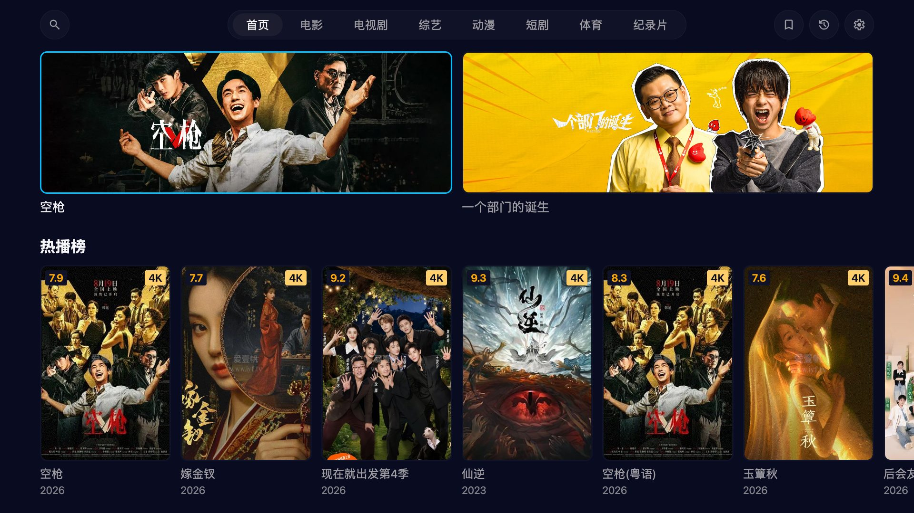
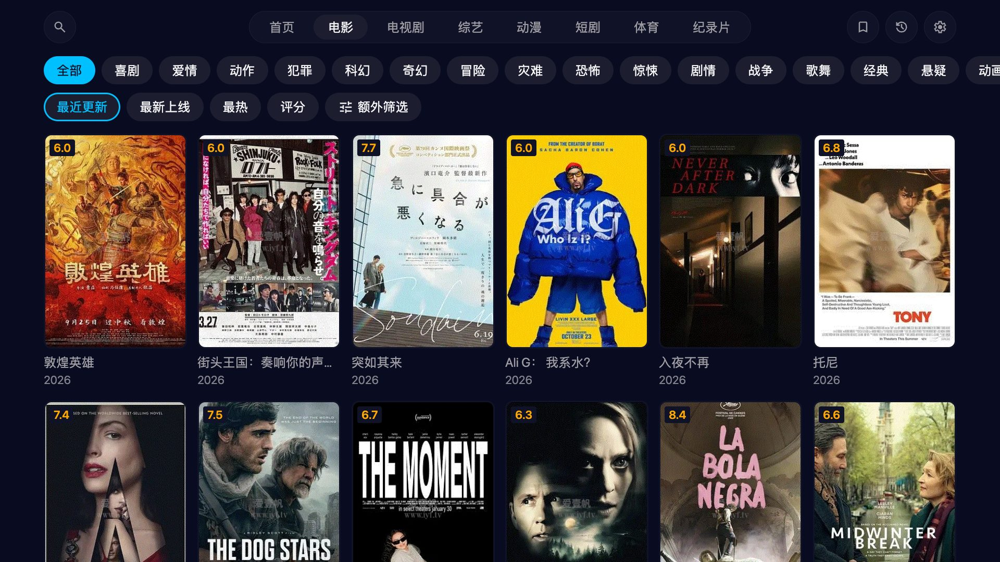
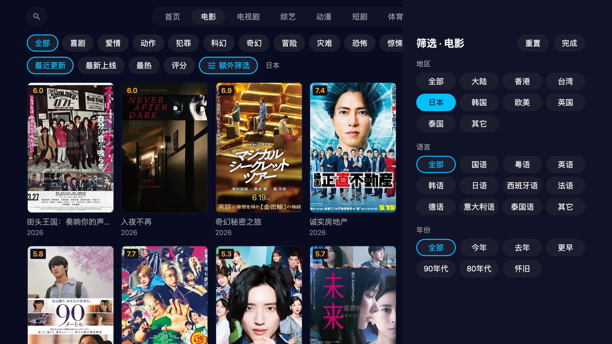
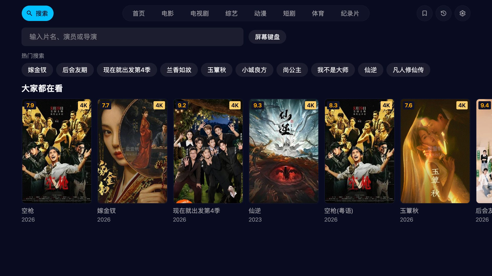
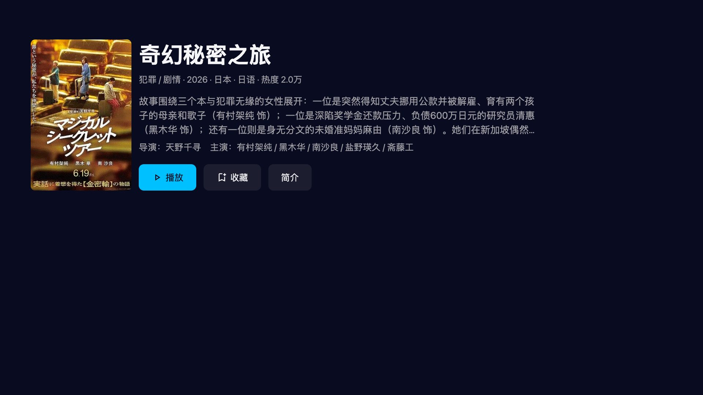
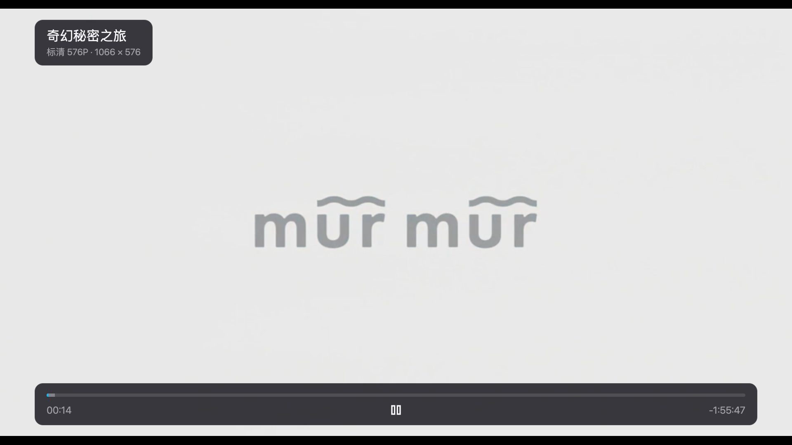
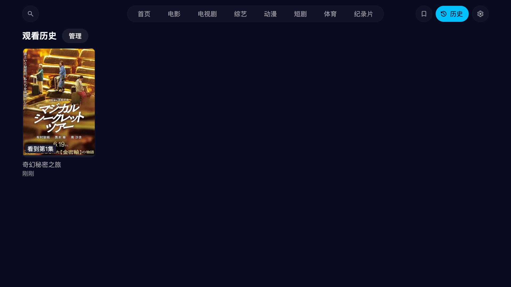
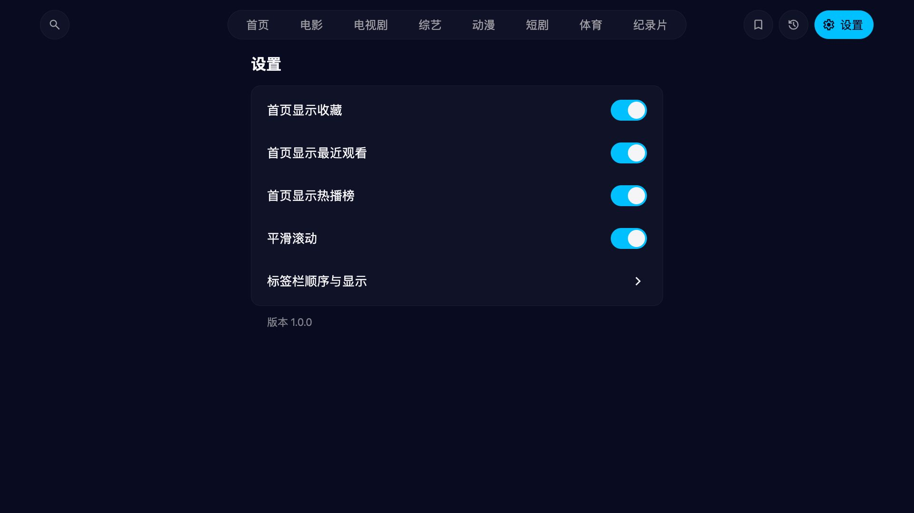

# 爱壹帆 · LG webOS TV

一个给 LG webOS 电视用的爱壹帆（yfsp.tv 国际版）客户端：在客厅里只用遥控器方向键，就能找片、看剧、接着上次的进度往下看。界面按 1080p 大屏设计，焦点移动不触发重渲染，结构和交互沿用作者的另一个项目欧乐影视 webOS 客户端。

这是个人项目，仅供学习交流，与爱壹帆官方没有任何关系。影片、海报和播放源都来自 yfsp.tv 的公开接口，相关权利归原权利人所有。

[安装教程](doc/install.md) · [遥控器操作](#遥控器操作) · [已知限制](#已知限制)

| | |
| --- | --- |
| 设备 | LG webOS 24 及以上（2024 年及之后的机型） |
| 操作 | 遥控器方向键、确认键、返回键；支持 Magic Remote 指针 |
| 安装 | 侧载 `.ipk`（开发者模式或已 root 的电视），不在 LG 应用商店上架 |
| 应用 ID | `com.yfsp.app` |



## 功能

### 首页

最上面是两张精选推荐（站点轮播里的广告已经滤掉），接着是「继续观看」「我的收藏」和「热播榜」，下面按电影、电视剧、综艺、动漫、短剧各放一排。热播榜把电影、电视剧、综艺、动漫四个周榜交替排在一起。继续观看的卡片上标着看到第几集和进度条，按确认就能接着看。这三排都可以在设置里关掉。

### 分类与筛选

顶部标签栏有电影、电视剧、综艺、动漫、短剧、体育和纪录片。每个频道先按类型筛一层，再选最近更新、最新上线、最热或评分排序；需要更细的条件时打开「额外筛选」，按地区、语言、年份过滤，剧集类频道还能选全集或连载中，短剧能选横屏或竖屏。选项即点即生效，列表往下滚会自动加载。站点每个条件最多给 30 页，翻到头时会提示换个筛选看更多。





### 搜索

按确认会弹出系统键盘，中文片名就在这里输入。输入停一下，下方会列出搜到的片名作为联想，选中即搜。站点的搜索不认拼音首字母，所以旁边的「屏幕键盘」只适合输英文片名和数字。搜索框为空时显示热门搜索、最近搜过的词和一排「大家都在看」。




### 详情与选集

详情页有简介、导演和主演、评分、地区、语言和热度。主按钮会根据观看记录变成「播放第 1 集」「继续观看第 N 集」或「重新观看」。剧集列表可以切换升序或降序，并且每部剧单独记住；集数超过 60 集时按 50 集一组分段，打开时自动定位到上次看的那一组。电影没有选集列表。



### 播放

- 打开就从上次的位置继续，屏幕上会提示从几分几秒开始。
- 左右键每次快进或快退 15 秒，按住不放会越跳越快，松手后才真正跳转。
- 剧集最后 30 秒弹出「即将播放」，按确认立即播放下一集；不管它，这一集结束后也会自动接上。
- 按下键呼出控制栏，再按下键打开选集条，播放中就能换集。
- 左上角显示当前清晰度和分辨率。播放地址带时效，过期后会自动换一个新地址接着播；网络卡顿时会跳过缓冲空洞、重新加载，尽量不打断观看。



### 收藏、历史与设置

收藏在详情页一键添加，顶部标签栏的书签图标进入收藏列表。观看历史最多保留 40 部，每部都带进度；进入「管理」可以逐条删除，也可以一次清空。设置里可以调整首页显示哪些内容、开关平滑滚动，还能自定义顶部标签栏的顺序和显隐。





## 遥控器操作

| 位置 | 按键 | 作用 |
| --- | --- | --- |
| 任意页面 | 方向键 / 确认 | 移动焦点 / 打开或执行 |
| 内容区 | 返回 | 回到顶部标签栏 |
| 顶部标签栏 | 左右 | 切换标签，页面随之切换 |
| 顶部标签栏 | 确认 | 立即切换；在首页和分类页上会回到页面顶部并重新加载内容 |
| 顶部标签栏 | 返回 | 退出应用（系统会先确认） |
| 详情页、弹窗、筛选面板 | 返回 | 关闭并回到上一处，焦点保持原位 |
| 播放中（控制栏隐藏） | 确认 | 暂停或继续 |
| 播放中（控制栏隐藏） | 左 / 右 | 后退或前进 15 秒，按住加速 |
| 播放中（控制栏隐藏） | 下 / 上 | 呼出控制栏 / 显示按键提示 |
| 播放中（控制栏显示） | 上 / 下 | 收起控制栏 / 打开选集条 |
| 选集条 | 左右 / 确认 | 选择剧集 / 切换到该集 |
| 选集条 | 上 / 返回 | 收起选集条 |
| 「即将播放」卡片 | 确认 / 上 | 立即播放下一集 / 关闭卡片 |
| 播放中 | 返回 | 收起控制栏；没有控制栏时退出播放 |
| 播放中 | 播放、暂停、快进、快退、停止 | 媒体键可用，快进、快退每次 30 秒 |

## 安装

1. 用 `bash build.sh` 打包，或从 Release 下载 `.ipk`。
2. 打开电视的开发者模式，用 `ares-install` 或 [webOS Dev Manager](https://github.com/webosbrew/dev-manager-desktop) 安装。
3. 开发者模式约 50 小时过期，过期后侧载的应用会被删除，记得定期续期。已 root 的电视没有这个限制。

完整步骤、升级和卸载见 [安装教程](doc/install.md)。

## 已知限制

- 不登录，只能播放免费的 576P（标清）；720P、1080P、4K 和会员剧集都播不了。
- 没有清晰度和线路切换，没有倍速、字幕样式、跳过片头片尾。
- 不做小视频、片单、弹幕、评论和投屏，不播放站点的贴片广告。
- 收藏和观看历史只保存在本机，卸载应用会一并清除。
- 如果站点要求人机验证，电视上过不了，只能提示稍后再试。
- 内容全部来自 yfsp.tv 的接口，接口调整、片源下架或网络问题都会影响使用。
- 目前只在桌面浏览器里完整验证过，还没在 webOS 24 模拟器或真机上跑过。

## 开发

```bash
cd app
npm install
npm run proxy    # 本地媒体代理（另开一个终端一直开着；播放必须经过它）
npm run dev      # 浏览器里开发，方向键、Enter、Esc 代替遥控器
npm run sim      # 构建后装进 webOS TV 模拟器
node --test      # 单元测试
node scripts/smoke.mjs   # 冒烟测试：真实请求走通列表、详情、取址和拉分片
cd ..
bash build.sh    # 打包 .ipk 到 out/
```

| 文档 | 内容 |
| --- | --- |
| [开发与构建](doc/development.md) | 本地开发、测试、打包、发版流程 |
| [架构概览](doc/architecture.md) | 数据通道、适配器与领域模型、导航、播放器、风险与未决问题 |
| [数据通道](doc/dev/data-channel.md) | Luna 服务、本地媒体代理、为什么三个环境都要代理 |
| [签名与请求信封](doc/dev/sign.md) | vv 签名、错误码、超时重试 |
| [焦点引擎](doc/dev/focus-engine.md) | 方向键导航如何做到零重渲染 |
| [本地存储](doc/dev/storage.md) | 收藏、历史、设置 |
| [播放器](doc/dev/player.md) | 取址、续播、令牌过期、自动下一集、卡顿恢复 |
| [打包与发布](doc/dev/packaging.md) | build.sh、appinfo.json、Release 工作流、真机调试 |
| [开发计划](doc/dev-plan.md) | M0 到 M5 的任务清单 |
| [调研记录](doc/research/) | 站点界面、接口、视频源和 olevod 复用地图 |

## 许可证

源码采用 [MIT License](LICENSE)。界面图标来自 Google 的 Material Symbols，按 Apache License 2.0 使用，见 [THIRD_PARTY_NOTICES.md](THIRD_PARTY_NOTICES.md)。爱壹帆的名称以及通过接口获取的影片、海报等内容不属于本项目，也不在该许可证范围内。
