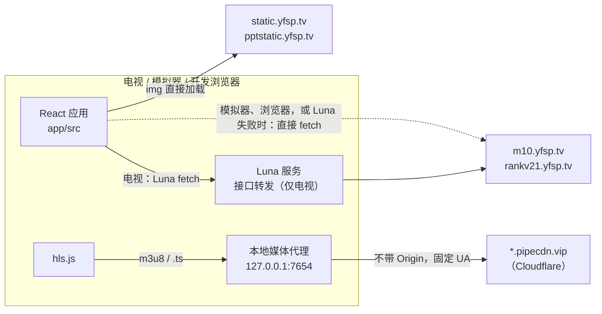
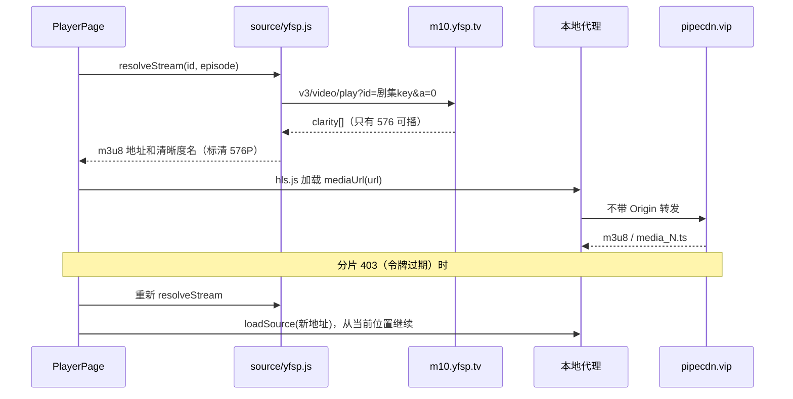

# 架构概览

这是爱壹帆（yfsp.tv 国际版）的 LG webOS 电视客户端：只用遥控器方向键找片、看剧、续播。数据来自 yfsp.tv 的公开接口，不登录也能用。

参考实现是欧乐影视客户端 olevod（`/Users/chenshi/Developer/olevod`）。两边的界面形态、焦点模型、存储和播放会话几乎一样，差别集中在数据源这一层：接口签名、响应格式、媒体 CDN 的访问规则。本文先讲整体结构，再逐块说明和 olevod 不同的地方。调研原始记录在 `doc/research/`，文中凡是写「实测」的结论都能在那里找到出处。

本文是开发前的设计稿，第 13 节列出的决策需要用户拍板后再开工。

## 1. 项目定位

- 设备：LG webOS 24 及以上（Chromium 108 内核），1920×1080 布局，遥控器方向键操作，兼容 Magic Remote 指针。
- 范围：站点的长视频部分，也就是电影、电视剧、综艺、动漫、短剧、体育、纪录片七个频道。小视频、新闻、片单、午夜版、直播、弹幕、评论都不做。
- 画质：未登录只能拿到 576P（标清），这是第一版的硬限制，见第 9 节和第 13 节。
- 分发：侧载 `.ipk`，不上架商店。仅供学习交流，与爱壹帆官方无关。

## 2. 目录

照搬 olevod 的布局，多一个 `source/`（数据源适配器），少了账号相关的文件。

```
app/
  src/
    config/      标签栏与分类配置（taxonomy.js、nav.js）
    api/         luna.js（环境握手、传输、mediaUrl）、feeds.js（缓存与预取）
    source/      yfsp 适配器：签名、请求信封、业务接口、字段归一化
    hooks/       焦点引擎 useFocus、本地存储 useStore
    store/       收藏、历史、设置、搜索记录、续播状态
    components/  卡片、标签栏、筛选面板、对话框、屏幕键盘
    pages/       首页、分类、搜索、详情、收藏、历史、设置（排行页视决策 D3）
    player/      播放器
    styles/
  scripts/       smoke.mjs：不经界面走通列表、详情、取址、经代理拉分片
  webos-meta/    appinfo.json 和图标，打包时合并进构建产物
service/com.yfsp.app.service/
                 Luna 服务：接口转发 + 本地媒体代理（代理也能在开发机上单独运行）
build.sh         构建并打包 .ipk
doc/             文档；doc/research/ 是调研记录
```

应用 id 是 `com.yfsp.app`，服务 id 必须以应用 id 为前缀，所以是 `com.yfsp.app.service`。

## 3. 数据通道

接口沿用 olevod 的分层：电视上优先走 Luna `fetch`，失败再直连；模拟器和浏览器直连。媒体和 olevod 不同，三个环境都必须走本地代理。



为什么这样分：

- 接口网关对任意 `Origin`（包括 curl 模拟的 `Origin: null`）都回显 `Access-Control-Allow-Origin`，不要 cookie、token、Referer，也不挑 User-Agent，所以模拟器和浏览器直连就能取到数据。但这只是 curl 的结论。olevod 的网关当时同样回 `ACAO: *`，真机打包后的 webview 跑在 `file://` 下却直连不通，最后才加了 Luna `fetch`（olevod `service.js` 开头的注释和 `doc/dev/data-channel.md`）。在真机验证（Q4）之前不能假定 yfsp 会不一样，所以电视上保留 olevod 的 `transportGet()`：Luna 服务就绪时走服务转发，失败或服务没起来再退直连。服务的接口白名单换成 `m10.yfsp.tv` 和 `rankv21.yfsp.tv` 两个主机，精确匹配。见决策 D2。
- 视频 CDN 在 Cloudflare 后面，规则是「Origin 和 Referer 不带可以，带就必须是 yfsp 自家域名」。hls.js 用 XHR 拉流，浏览器一定会带上 `Origin`：电视上是 `null`，开发时是 `http://localhost:5173`，都会被回 520。这个头 JS 改不掉，所以媒体必须经一个能控制出站头的本地代理。
- 图片 CDN 没有防盗链、带 `ACAO: *`，`` 直接加载，不进代理。

一个和 olevod 不同的后果：olevod 在浏览器和模拟器里播放不需要代理，这里三个环境都需要。所以代理写成一个能独立运行的 Node 脚本：

- 电视上：Luna 服务启动时拉起代理，前端在首帧前通过 Luna `ping` 拿到实际端口（端口占用时会自增）。
- 模拟器和浏览器开发：在 Mac 上 `npm run proxy` 单独运行同一份代码，监听固定的 `127.0.0.1:7654`。前端 Luna 握手失败后，再用 HTTP 请求一次 `http://127.0.0.1:7654/ping`，通了就用它。开发页面的源是 `http://localhost:5173`，跨源读 `/ping` 的响应需要 `ACAO: *`；olevod 的代理对 `/proxy/` 以外的路径一律 404、也不加 ACAO，这里要补上。模拟器能不能访问宿主机的 127.0.0.1 还没验证，见 Q3。

olevod 的 `luna.js` 有两处 `isTV` 前置条件：`initTvEnv()` 开头 `if (!isTV) return`，`mediaUrl()` 只在 `isTV && serviceReady` 时改写地址。浏览器和模拟器也要走代理，所以这两处要改成「拿到代理端口就改写」，接口传输仍然只在 `isTV && serviceReady` 时走 Luna。环境判定和传输选择仍然只在 `app/src/api/luna.js` 一个文件里发生，业务层不知道自己在哪个环境。

### 代理的出站规则

在 olevod 的 `service.js` 骨架上改出站头和白名单。要说清楚的是，下面这套规则还没有端到端播过：`mvp/proxy.cjs` 在桌面 Chrome 里用 hls.js 1.5.17 播通时，出站一直带着 `Referer: https://www.yfsp.tv/`，白名单是 `pipecdn.vip`、`global-cdn.me`、`yfsp.tv` 三个固定后缀，还会改写 m3u8 里的绝对地址。「不带 Referer」「m3u8 不改写」只有 curl 和 `probe.cjs` 的直连请求作证。M1-4 的完成标准里补了一条：用按本节规则写的代理配 hls.js light 实际播一段。2026-10-29 已在 M1-4 验证：`service.js` 按本节规则（不带 Referer、m3u8 不改写、后缀加路径白名单）配 hls.js light，在桌面浏览器里从 `http://127.0.0.1:8099` 起播，`currentTime` 10 秒内走到 10，没有报错。

- 不发 `Origin`，不转发客户端的 `Origin`、`Referer`、`Cookie`。`Referer` 也不带（带 `https://www.yfsp.tv/` 同样能过，但少一个指纹更好）。olevod 的 `Referer: https://www.olevod.com/` 在这里会被 520。
- `User-Agent` 固定成一个 webOS 的 Chrome UA。CDN 对 `curl/*`、`python-requests/*` 回 403。
- 透传 `Range`，出站 `Accept-Encoding: identity`（代理按字节转发，不能让上游给 gzip）。
- 回写状态码、`Content-Type`、`Content-Length`、`Content-Range`、`Accept-Ranges`，加 `ACAO: *`。上游的 403、520 原样回给播放器，前端靠它区分「地址过期」和网络错误。
- m3u8 不改写：分片是相对路径，经代理加载时自然也走代理。
- 白名单：CDN 域名是随机生成、会轮换的 `.vip` 域名（`upload.yfsp.tv` 的预览接口一次就给出了 20 个不同域名），固定后缀表维护不了。推荐规则是 host 以 `.vip`、`.yfsp.tv` 或 `.global-cdn.me` 结尾，并且路径以 `.m3u8` 或 `.ts` 结尾。校验必须用 `new URL()` 解析后的 `hostname`，并拒绝带 `username` / `password` 的地址：MVP 最初按字符串截 host，`/proxy/pipecdn.vip:x@example.com/` 就被转发到了 example.com，复核时才修掉。代理只监听 127.0.0.1，不会变成对外开放的代理。另一种做法见决策 D8。
- keepAlive 的 TLS 连接、出错断干净、`uncaughtException` 只记日志、注册 keepAlive activity，这些照搬 olevod。日志写 `/tmp/yfsp-service.log`。

## 4. 数据源适配器与领域模型

页面和 `feeds.js` 只 import `app/src/source/index.js`，它 re-export `yfsp.js`。不做运行时可切换的多源注册表，项目只有一个源。

```
app/src/source/
  index.js       export * from './yfsp.js'
  yfsp.js        业务接口 + 字段归一化，输出下面的领域模型
  yfspHttp.js    请求信封：选主机、签名、发送、解包、错误码映射、超时重试
  yfspSign.js    纯函数：md5、canonicalQuery、sign，配 node --test 向量
```

### 对页面暴露的函数

| 函数 | 用到的接口 | 返回 |
| --- | --- | --- |
| `categoryList({category, filter, page, size})` | `m10/api/list/Search` | `Page<Summary>` |
| `homeBanners()` | `m10/v3/home/getflashbanner`（需 `region`，先取 `getmyregion`） | `Banner[]`，过滤掉 `external:true` 的广告；失败返回 `[]` |
| `homeShelves()` | `m10/v3/home/getAllVideo`（一次请求拿到全部频道） | `[{ key, title, categoryId, items: Summary[] }]` |
| `rankList()` | `rankv21/api/list/GetVideoRank?key=All` | `{ [categoryId]: { week, month, year } }`，视决策 D3 |
| `searchHotKeywords(limit)` | `rankv21/v3/list/gethotsearchlist` | `string[]`，取第一组（影视） |
| `searchList({keyword, page, size})` | `POST rankv21/v3/list/briefsearch` | `Page<Summary>`，只要影视结果 |
| `detail(id)` | `m10/v3/video/detail` + `m10/v3/video/languagesplaylist?taxis=1` | `Detail` |
| `resolveStream(id, episode)` | `m10/v3/video/play` | `Stream`，不可播时抛 `ApiError` |
| `imageUrl(pic, size)` | 无，拼 `static.yfsp.tv` 缩放参数；`size` 是 `Thumb` 传的 `'384x560'` 这种字符串 | 完整图片 URL |

olevod 有、这里没有的：`searchSuggest`（站点没有联想接口，见决策 D5）、`captcha` / `login` / `userInfo`（不做账号）。

### 领域模型

和 olevod 最大的区别是统一字段名。olevod 列表用 `name/score/area`、详情用 `title/rating/region`，页面里有两段手写映射；这里详情就是摘要加字段，另导出 `toSummary(detail)` 给收藏和历史用。字段只收页面实际会读的。

Summary（卡片、收藏、历史共用）：

| 字段 | 来源 | 说明 |
| --- | --- | --- |
| `id` | 列表 `key`，搜索和排行里是 `contxt`，轮播里是 `listPath` | 11 位字符串，路由参数和存储主键 |
| `name` | `title` | |
| `pic` | `image` 或 `imgPath` | `imgPath` 可能带 `s` 后缀，按站点做法 `replace('s.', '.')`；排行里是相对路径，补 `https://static.yfsp.tv` |
| `score` | `rating` / `score` | 转成 number，0 表示没有 |
| `remarks` | `lastName` | 「22」「18集全」，电影一般为空 |
| `year` / `area` | `year` / `regional` | |
| `lang` | `lang` / `language` | 新增，详情页标签用 |
| `uhd` | `vipResource` 是 `4K` 或 `2K` | 新增，卡片右上的 4K 角标。判断式取自站点主包的卡片模板；olevod 用正则匹配 `remarks`，在这里永远不会命中 |
| `cid` | `videoClassID` / `cid` | 分类路径如 `0,1,4,132`，选集接口要用；适配器内部字段 |

站点卡片右上还有一个红底角标：主包里是 `updates = isShowTodayNum ? todayNum : 0`，大于 0 时显示，电影显示「新」，其他频道显示数字。但抽查 `getAllVideo` 和 `list/Search` 的返回，`isShowTodayNum` 有、`todayNum` 这个字段却不存在，按站点的写法角标根本不会出现。来源没查清（Q9），第一版不放这个角标，模型里也不加字段。

`picThumb` 不进模型：站点图片支持服务端缩放，`Thumb` 直接按卡片尺寸请求 `?w=&h=&format=jpg&mode=crop`，不需要 olevod 那套缩略图后缀和拉伸检测。

Detail（= Summary 加以下字段）：`genreName`（`cidMapper`）、`director`、`cast`（`directors[]`、`stars[]` 拼成文本）、`synopsis`（`contxt`）、`hot`（`view`，热度）、`episodes`。站点电影还有一个第三方评分（疑似豆瓣），接口调研里没有找到对应字段，第一版不做。

Episode：

| 字段 | 说明 |
| --- | --- |
| `index` | 从 1 开始的整数，按升序位置编号。续播、下一集、选集分段只认它 |
| `title` | 接口的 `name`，如「01」「0801」「SP01」，电影是「1080P」这类，电影的集名页面不显示 |
| `vip` | `isVip` |
| `key` | 剧集 key，`resolveStream` 用，页面不解读 |

选集接口要用 `taxis=1`：长剧集在 `taxis=0` 下顺序是乱的（《海贼王》从 0801 开头），`taxis=1` 才是 0001 到 1180 再接 SP01 到 SP04。接口不分页，《海贼王》的 `playList` 一次返回 1182 项（复核时重新取过）：编号 0001 到 1180 里 0268-0269、0277-0278 各合并成一项，所以是 1178 项正片加 4 个 SP。SP 排在 1180 之后，看完 1180 按「下一集」会进 SP01。这和站点 `taxis=1` 的顺序一致，第一版照此处理，不单独把 SP 挑出来。

多语言版本：选集接口叫 `languagesplaylist`、带 `lsk=1`，名字看上去能按语言分组，但抽了 24 部粤语片，`lsk` 取 0 或 1 时 `info` 都只有一项。站点上的语言版本要么单独成片（「新闻女王(粤)」），要么是同一部片里的不同剧集（《叶问3》的 `playList` 是「1(国语)」「1(粤语)」），两种在我们的模型里都能自然显示。所以适配器只取 `info[0]`，不做语言切换；`lsk` 的含义和有没有多项 `info` 的片留作 Q10。

数组顺序沿用 olevod 的「新的在前」，这样 DetailPage、PlayerPage、`episodeOrder` 都不用改，见决策 D4。

Stream：`{ url, type: 'hls', label }`。`url` 是未经代理的 m3u8，播放器再过 `mediaUrl()`；`label` 是清晰度名（「标清 576P」），给左上角画质卡片用。

其余：`Category`、`Option`（`'0'` 表示全部）、`Filter`、`Banner { id, name, pic }`、`Page<T> { items, total, page, size }`，和 olevod 草案一致，`Filter` 的字段见第 6 节。

## 5. 签名与请求信封

yfsp 没有载荷加密，响应是明文 JSON，这一节比 olevod 简单很多。

签名（`yfspSign.js`，从站点主包 `uriSignature()` 整理，10 个浏览器真实请求收作 `yfspSign.test.js` 的测试向量）：

```text
canonical(qs): 按 & 拆开，值 decodeURIComponent，"+" 换成空格，按原顺序拼回
vv  = md5_hex(pub + "&" + lower(canonical(qs)) + "&" + privateKey)
GET : url + "&vv=" + vv + "&pub=" + pub
POST: body + "&vv=" + vv + "&pub=" + pub      （URL 上的 query 不签）
```

`pub` 用当前毫秒时间戳，`privateKey` 从站点内置的 8 项表里按 `pub % 8` 取。这是站点自己的兜底模式，网关不校验时效（前后偏一周都能过），所以不用先抓首页，也不依赖电视时钟准不准。备用方案是解析首页 HTML 里的 `pConfig`，签名函数不用改，只换 `pub` 和 `privateKey` 的来源；第一版不写，等兜底模式真被收紧再加。

参数要点：`m10` 和 `rankv21` 下的请求统一追加 `v=1`，它参与签名，要先拼再签，这件事由信封做；`cinema=1` 不由信封统一追加，各业务函数照站点的参数原样写，因为有例外：影视搜索 `briefsearch` 恰好不带 `cinema`（带 `cinema=3` 的那次是用户上传视频），筛选项接口 `GetSearchCondition` 也只有 `version=1&v=1`；参数按发出顺序签，不排序。部分接口站点自己不签（首页、菜单、热搜），客户端一律签上，对它们无害。浏览器里 MD5 没有原生实现，拷 olevod `sign.js` 里的 md5。

请求信封（`yfspHttp.js`，骨架来自 olevod 的 `http.js`）：

- 主机按接口选：`m10.yfsp.tv` 放列表、详情、选集、播放，`rankv21.yfsp.tv` 放排行、搜索、热搜。业务函数里写相对路径加主机名常量。
- 响应外层是 `{ret:200, data:{code, msg, info:[...]}}`，HTTP 总是 200。`data.code === 0` 才算成功，返回 `data.info`（大多数接口取 `info[0]`，由业务函数自己取）。
- 非 0 抛 `ApiError(msg, code)`。code 1 是业务错误（签名错、视频不存在）；code 4 站点会弹一个 prevent 对话框，原因没查清，按通用 `ApiError` 处理，用 `msg` 作文案、记日志、不重试；code 5 表示网关要求人机验证（Cloudflare Turnstile），电视上过不了，单独给文案「访问受限，请稍后再试」，并停止一切自动重试和预取。code 2、3 只有登录态会遇到，同样按通用 `ApiError` 处理。
- GET 3 秒超时、最多 3 次、每次重新签名；`ApiError` 不重试；POST（只有搜索）8 秒、不重试。这些数值照搬 olevod，olevod 文档里有原因。
- 启动预取保持 olevod 的顺序执行，不并发。高频请求多久会触发 code 5 还不知道（Q6），宁可慢一点。

## 6. 导航与分类配置

和 olevod 一样配置驱动：分类树冻结在 `app/src/config/taxonomy.js`，标签栏、路由、分类页都从这里读，首帧不等网络。数据来源是 `m10/v3/list/MainMenuV3`（频道）、`m10/api/list/AllVideoType`（每个频道的类型）和 `m10/v3/list/GetSearchCondition`（其余筛选维度和每个频道显示哪些维度），抓一次写成静态数据。

标签栏：搜索（图标）、首页、电影、电视剧、综艺、动漫、短剧、体育、纪录片，然后是收藏、历史、设置三个图标。去掉 olevod 的「VIP蓝光」和账号。是否加「排行」见决策 D3。用户仍可在设置里调整中间标签的顺序和显隐。

分类 id 用频道 slug（`movie`、`drama`…），频道的 `cid`（`0,1,3`）作为配置字段。olevod 的 `getCategory` 里有 `Number(id)`，要改成字符串比较。

筛选维度和 olevod 差别较大：

| 维度 | `list/Search` 参数 | 取值 | 哪些频道有 |
| --- | --- | --- | --- |
| 类型 | `cid`（类型路径，如 `0,1,3,19`） | 每个频道不同 | 体育以外 |
| 地区 | `region` | 大陆、香港、台湾、日本、韩国、欧美、英国、泰国、其它 | 全部 |
| 语言 | `language` | 国语、粤语、英语等 11 项 | 全部 |
| 年份 | `year` | 今年、去年、更早、90年代、80年代、怀旧（传中文字面值） | 全部 |
| 画质 | `vipResource` | 4K、1080P、900P、720P | 全部 |
| 状态 | `isserial` | 全部 -1、全集 0、连载中 1 | 剧集类 |
| 形式 | `isVertical` | 全部 -1、横屏 0、竖屏 1 | 短剧 |
| 排序 | `orderby` + `desc=1` | 0 添加时间、1 更新时间、2 人气、3 评分 | 全部 |

没有片名首字母。哪个频道显示哪些维度以 `GetSearchCondition` 的 `orders[]` 为准，写进每个分类的配置。因此 FilterPanel 从 olevod 的三组写死改成遍历 `cfg.panelFilters`，`store/filters.js` 的默认值跟着改（决策 D6）。画质筛选只影响列表，不代表能播到那个画质，界面上要不要露出来也在 D6 里一起定。

分页：接口是页码分页，`maxpage` 封顶 30。前端继续做滚动自动加载，用 `items.length >= total` 或 `page >= maxpage` 判断结束；每页取 36 条。

## 7. 焦点引擎

原样沿用 olevod 的 `useFocus`：焦点移动只切 DOM class、直接滚动所在容器，不触发 React 重渲染；返回键链、文本框按键透传、Magic Remote 指针都在这里统一处理。它依赖 `store/settings.js` 的 `smoothScroll`，要一起带过来。细节见 olevod 的 `doc/dev/focus-engine.md`，开工时拷成本仓库的 `doc/dev/focus-engine.md`。

唯一要改的是视觉：网页没有键盘焦点样式，焦点态按第 11 节重新定。

## 8. 页面

| 页面 | 来源 | 和 olevod 的差别 |
| --- | --- | --- |
| 首页 | 改造 | 轮播（过滤广告帧）、继续观看、我的收藏、五个频道货架（电影、电视剧、综艺、动漫、短剧）。货架数据来自 `homeShelves()` 一次请求，不再前端拼四次分类列表 |
| 分类页 | 改造 | 换筛选面板（第 6 节）；加载结束条件加上 `page >= maxpage` |
| 搜索 | 改造 | 热门搜索用 `gethotsearchlist`；结果只留影视。没有联想接口，屏幕键盘的去留见 D5 |
| 详情 | 改造 | 字段统一后去掉手写映射；加热度、语言标签；50 集分段和正倒序沿用；VIP 集显示锁标，点了提示「会员剧集，暂不支持」 |
| 播放器 | 改造 | 取源改成 `await resolveStream()`，见第 9 节 |
| 收藏、历史、设置 | 沿用 | 只改存储键前缀 |
| 排行 | 视 D3 | 一次请求拿到电影、热剧、综艺、动漫四个榜的周、月、年 |
| 账号 | 不做 | 见第 10 节 |

页面之间只传影片 id，详情经 `feeds.loadDetail(id)` 缓存，进播放器不重复请求，这条约定保留。

## 9. 播放器

`player/playbackSession.js` 的 hls.js light、续播、卡顿看门狗、进度采样都不动，但它要小改：olevod 把 hls.js 的致命错误压成 `network` / `decode` / `source` 三类，不带 HTTP 状态码，而下面的令牌过期恢复要靠 403 判断，所以错误回调要带出 `response.code`。其余改动集中在 `PlayerPage.jsx` 的取源和错误处理。



取源规则：

- 统一用剧集 key 配 `a=0` 请求 `video/play`。影片 key 配 `a=1` 只取默认集，搭配错了会返回「视频不存在」。电影也有一条剧集，同样走剧集 key。
- 正片地址取 `clarity.find(c => c.isEnabled && c.path).path.result`，兜底 `flvPathList.find(p => p.isHls && !p.link).result`。`flvPathList` 里 `isHls:false` 的那条是 20 秒前贴片广告，`pauseData` 是暂停广告，都忽略。
- 都取不到就抛 `ApiError`：`needLogin` 非 0 或该集 `isVip` 时文案是「会员内容，暂不支持」，否则是「片源不可用」。
- 地址不缓存到本地存储。m3u8 的 `vendtime` 约 48 小时，里面签进了请求方的公网 IP，每次进播放器都重新取。

清晰度：未登录只有一档可播，没有线路。第一版不做清晰度选择，左上角画质卡片显示 `label` 和 hls.js 报的实际分辨率（实测 576 档的宽银幕片是 864×362，约 550 kbps）。VIP 档不展示，避免点了没用（决策 D7）。olevod 的 `pickStartLevel()` 在单档媒体列表上不起作用，留着无害。

续播和下一集：完全沿用 olevod 的 `store/watchState.js`，只认 `episodes[].index`。打开详情时主按钮是「播放第 1 集」「继续观看第 N 集」或「重新观看」，剧集最后 30 秒弹「即将播放」。站点打开《海贼王》默认跳到 0801，是 `taxis=0` 乱序导致的，我们用 `taxis=1` 并且默认集由本地历史决定，不受影响。

错误恢复，相对 olevod 新增两条：

- 分片 `verify` 令牌的有效期不确定（实测 5 分钟以上仍有效，可能是 48 小时）。hls.js 报 `fragLoadError` 且状态码是 403 时，olevod 的软重载只会 `startLoad(pos)` 用旧地址重试，在这里没用。改成重新 `resolveStream`，`loadSource` 新地址后从当前位置继续；连续两次仍 403 才报错。
- `ApiError` code 5 直接显示访问受限的文案，不重试。

站点有的倍速、跳过片头片尾、字幕样式、弹幕，第一版都不做。

## 10. 账号

第一版不做登录，理由：

- 登录是 `account.yfsp.tv/Auth/Login` 的服务端表单（邮箱或手机号加密码），成功后靠 `account.yfsp.tv` 的 cookie 做 SSO，主站再换 token。`file://` 下的 cookie 行为不确定，要做大概得把整个流程搬进 Luna 服务里维护 cookie。
- 调研时不允许登录，登录后非会员能不能拿到 720P、VIP 档的流是什么格式，都没有验证。
- 早先的猜测「登录要过 Turnstile 或 reCAPTCHA」被接口调研修正了：人机验证是全局兜底（任意接口返回 code 5 时），不在登录表单里；表单有个隐藏字段 `requirecode`，推测失败几次后才要验证码。所以登录在技术上未必做不到，只是收益未知。

因此去掉 olevod 的 `store/session.js`、`store/vault.js`、`pages/AccountPage.jsx` 和账号标签，VIP 集只做提示。什么时候重新考虑：有人用真实账号确认过「登录后能拿到更高画质」之后，再单独立项（决策 D1）。

## 11. 界面风格

配色跟站点走，一眼能认出是爱壹帆（决策 D9）。数值来自网页的 computed style：

| 用途 | 值 |
| --- | --- |
| 页面背景 | `#090b21`（偏蓝的深藏青） |
| 面板、选集按钮底 | `#101227` |
| 标签底 | `#1c1d2f` |
| 主色、选中、焦点 | `#00c0ff` |
| 评分 | `#ffa800` |
| 热度数字 | `#ff743d` |
| 「新」角标 | `#ff0000` 底白字 |
| VIP 金色 | `#fec1a1` |
| 正文 / 次要 / 简介 | `#ffffff` / 白色 40% / 白色 70%（写成不透明的等效色） |

- 字体用系统字体栈，和站点一致；字号按 10-foot 规格放大，沿用 olevod 的 22–60px 档位。
- 焦点态：主色 `#00c0ff` 描边加轻微放大，替换 olevod 的白色描边。网页只有 hover，没有可抄的。
- 卡片：竖版海报，比例 0.7，角标布局照网页（评分或「更新 N / N集全」压在底部渐变上，右上 4K，读 Summary 的 `uhd`）。网页右上的红色「新」角标数据来源没查清（第 4 节、Q9），第一版不做。圆角用 olevod 的 14px，网页的 6px 在电视上显得生硬。
- 硬约束照抄 olevod 的 `index.css`：颜色写成不透明值、不用 `color-mix`（Chromium 108 不支持）、不做持续动画。
- 应用图标自己画，不用站点 logo 原图。

## 12. 与 olevod 的复用关系

概括来说：焦点引擎、存储、播放会话、组件库、构建打包几乎原样拷贝，只改 `olevod` 前缀；数据源相关的 `api/olevod.js`、`sign.js`、`http.js` 的信封部分整个替换为 `source/`；账号相关的全部不带。逐文件的分类和理由见 [doc/research/olevod-reuse.md](research/olevod-reuse.md)。

那份复用地图写在接口调研之前，有几处假设已被推翻，以本文为准：

| 复用地图里的假设 | 实际（有运行证据） |
| --- | --- |
| 接口主机是 `api8.` 和 `m10.` | `cinema=1` 时是 `m10.` 和 `rankv21.`，`api8.` 属于姊妹站（`cinema=2`） |
| 可能有 AES 载荷 | 明文 JSON，主包里没有任何加解密代码 |
| 浏览器开发可能要给接口配 Vite 代理 | 接口不用；反而媒体在所有环境都要代理 |
| Luna 服务保留接口转发 | 保留，主机白名单换成 `m10` / `rankv21`；模拟器和浏览器直连（决策 D2） |
| 搜索联想和拼音首字母可以照搬 | 站点没有联想接口（决策 D5） |
| `service.js` 媒体带 `Referer: https://www.yfsp.tv/` | curl 证明不带也行，推荐不带，但还没端到端播过；关键是不发 Origin、不用 curl UA |

另外几处被列成「原样」的文件其实和 olevod 的数据形状耦合，复用地图第二节已改成「改造」，开发计划对应任务也列上了：

| 文件 | 要改什么 |
| --- | --- |
| `store/filters.js` + test | `DEFAULT_FILTER` 去掉 `letter`，换成第 6 节的维度 |
| `components/FilterBar.jsx`、`FilterPanel.jsx` | 去掉 `DEFAULT_LETTER`、`LETTERS` 和写死的首字母组，改成遍历 `cfg.panelFilters` |
| `components/VideoCard.jsx` | 4K 角标改读 `uhd`；去掉传给 `Thumb` 的 `picThumb` |
| `components/KeyboardPanel.jsx` | 占位和底部提示写死了「拼音首字母」，按 D5 / Q7 改文案 |
| `pages/CategoryPage.jsx` | 加载结束条件加 `maxpage` |
| `player/playbackSession.js` + test | 致命错误回调带出 HTTP 状态码 |
| `api/luna.js` | 去掉 `initTvEnv()` 和 `mediaUrl()` 的 `isTV` 前置条件（第 3 节） |

## 13. 风险、未决问题与待拍板的决策

### 调研结论之间的出入

几份调研写于不同阶段，有冲突时以有运行证据的为准：

- 排序值：界面调研猜测网页 URL 的「添加时间」「更新时间」是 `orderBy=1`、`4`；接口调研给出的是接口参数 `orderby` 的 0 添加、1 更新、2 人气、3 评分。客户端用接口参数，按后者实现，M1 用返回结果的日期再确认一次（Q1）。
- 筛选参数名：网页 URL 用 `bitrate`、`status`，接口用 `vipResource`、`isserial`。客户端只用接口参数名。
- 指定剧集播放（剧集 key 配 `a=0`）：MVP 最初只在浏览器里见过，复核时已用脚本验证（《青之花器之森》第 02 集取址成功，经代理用 hls.js 播放正常；剧集 key 配 `a=1` 返回「视频不存在」）。Q2 已关闭，M1-5 的测试照常覆盖。
- 选集顺序：MVP 用的是 `taxis=0`，接口调研证明长剧集要用 `taxis=1`。采用 `taxis=1`。
- 接口通道：视频源调研和接口调研都用 curl 测到网关对 `Origin: null` 回显 ACAO，据此一度打算删掉 Luna `fetch`、接口全部直连。但 olevod 的网关当时也回 `ACAO: *`，真机 webview 从 `file://` 直连却走不通。curl 证明不了真机 webview 的行为，所以采用视频源调研的建议，保留 olevod 的分层（电视上 Luna 优先、失败退直连），见 D2。
- 「不带 Referer」：只有 curl 和 `probe.cjs` 的直连对照；MVP 代理播通时一直带着站点 Referer。按不带 Referer 设计，M1-4 端到端补验。
- 签名规范化：MVP 最初对原始查询串直接转小写签名，中文参数（`region=大陆`）会被网关判为「用户签名错误」。已改成照站点 `get_query()` 先 `decodeURIComponent` 再签，`sign-check.mjs` 里加了中文向量和线上用例。
- 地区：界面调研怀疑片库随 `region` 变化；接口调研实测 `region` 改成别的值播放地址不变，地区由服务器按 IP 判断，只有轮播接口不带 `region` 时为空。客户端只在轮播上带 `getmyregion` 返回的地区码，其余接口照抄站点参数。
- 首页数据：复用地图建议从首页 HTML 内联 JSON 取分区；接口调研找到了不用签名的 `getAllVideo`，采用后者。

### 风险与应对

| 风险 | 应对 | 需要用户决定吗 |
| --- | --- | --- |
| 未登录只有 576P（864×362 左右，约 550 kbps），大电视上偏糊 | 第一版接受；画质卡片如实显示 | 是，D1 |
| CDN 对 `Origin: null` 和非自家 Origin 回 520 | 本地代理去掉 Origin，三种环境都走代理；MVP 代理（带站点 Referer、固定白名单）已在桌面 Chrome 里播通，本文规则的代理在 M1-4 端到端验证 | 否 |
| 真机 webview 从 `file://` 直连接口不通（olevod 遇到过） | 电视上 Luna `fetch` 优先、失败退直连；M3 之后的检查点在真机或 webOS 24 模拟器上验证（Q4） | 是，D2 |
| 模拟器里没有 Luna 服务，播放依赖开发机上单独跑的代理 | `npm run proxy` 加 HTTP 握手兜底（`/ping` 带 `ACAO: *`）；若模拟器访问不了宿主机 127.0.0.1，模拟器里只能测到取址这一步，播放要在浏览器或真机上看 | 否，M1 验证（Q3） |
| `npm run sim` 启动的是 webOS 26 模拟器，内核比目标的 Chromium 108 新，日常手测发现不了兼容问题 | 平时靠 Vite `target: chrome108` 和 `index.css` 的硬约束；M3 播放打通后加一个检查点，用 webOS 24 模拟器或真机跑一遍 | 否。M3-4 检查点（2026-10-29）没跑成：本机只有 webOS 26 模拟器，没有 24 模拟器和真机；改做了静态检查，构建产物里唯一的 `color-mix()` 在 Tailwind 的 `@supports` 保护里（和 olevod 一样），JS 里没有 108 以后的 API。真机或 24 模拟器上的检查留到 M5-4 |
| 代理白名单被 URL userinfo 绕过 | 按解析后的 `hostname` 校验并拒绝 userinfo（MVP 已修、已验证 403） | 否 |
| 接口返回 code 5（Cloudflare Turnstile），电视上过不了 | 单独文案、停止重试和预取；请求保持顺序执行、不并发 | 否 |
| 时间戳签名是站点兜底路径，可能被收紧 | 改为解析首页 `pConfig`，签名函数不用改 | 否 |
| m3u8 和分片令牌过期 | 分片 403 时重新取址续播 | 否 |
| m3u8 里签进了请求方 IP | 电视上取址和拉流同一出口，不受影响；开发时别把开发机取到的地址丢给别的网络的设备 | 否 |
| CDN 域名随机轮换 | 白名单按 `.vip` 后缀加媒体路径放行 | 是，D8 |
| 只在美国出口测过，国内网络的 CDN 节点和规则未知 | 第一版不处理，出问题再看日志 | 否 |
| 站点接口变动、片源下架 | 和 olevod 一样，README 里写明 | 否 |

### 开发中验证的问题

- Q1：`list/Search` 的 `orderby` 0 和 1 是否分别是添加时间和更新时间。已关闭（M1-6）：电视剧频道 `orderby=0` 的前 5 条 `addTime` 严格递减（10 月 28 日到 26 日），`orderby=1` 的前 5 条加入时间分散在 9 月到 10 月、都是正在更新的剧，确认 0 是添加时间、1 是更新时间。
- Q2：已关闭。剧集 key 配 `a=0` 在脚本里能取到指定剧集的地址并播放（M1-5 的 `yfsp.test.js` 和 `app/scripts/smoke.mjs` 都走这条路）。
- Q3：webOS 模拟器里的应用能否访问宿主机 `127.0.0.1:7654`。M3-2 的播放在桌面浏览器里验证（首页进详情、播放、续播记录写入历史），模拟器里还没测。
- Q4：真机 webview 从 `file://` 直连接口能否成功（决定 Luna 失败时退直连有没有用；olevod 的经验是不通），Luna 转发和代理在 Node 16 上是否正常，界面在 Chromium 108 上是否正常。在 M3 之后的检查点验证，发布前真机再确认一次。
- Q5：分片 `verify` 的确切有效期，决定长时间暂停后的恢复体验。M3-3（2026-10-29）已实现并验证恢复路径：测试代理让分片持续回 403，播放器重新 `resolveStream`、换新地址后从原位置继续，没有出错页；单次 403 会被 hls.js 自己的重试吃掉，不触发换址。真实有效期（暂停 30 分钟以上）还没测。
- Q6：多大的请求量会触发 code 5。
- Q7：`briefsearch` 是否支持拼音首字母，`orderby` 各值的含义。拼音部分已关闭（M1-6）：`qyn` 返回 0 条，不支持拼音首字母，按 D5 的退路在屏幕键盘上默认切到系统输入法（M2 实现）。`orderby` 继续用站点默认的 4。
- Q8：VIP 集未登录时 `play` 的实际返回（`isPreView` 试看、`needLogin`），决定提示文案。M1-5（2026-10-29）在电视剧、电影、动漫按更新时间各扫了 12 部，选集里没有一集是 `isVip`，站点的 VIP 主要体现在清晰度档位上。适配器目前在没有可播档位时，按 `isVip` 抛「该集需要 VIP 会员」，否则抛「暂时无法播放」；遇到真实的 VIP 集再核对。
- Q9：卡片红色「新」/ 更新数角标的数据来源。站点读 `todayNum`，抽查的列表和首页返回里没有这个字段。查不到就一直不做。
- Q10：`languagesplaylist` 的 `lsk` 含义，有没有 `info` 多于一项的片。第一版只取 `info[0]`。

### 待拍板的决策

每条后面是推荐做法。2026-10-28 已全部按推荐做法拍板。

- D1 账号与画质：第一版不做登录，只播 576P，VIP 集只提示。
- D2 接口通道：保留 olevod 的 `transportGet()` 分层，电视上 Luna `fetch` 优先、失败退直连，模拟器和浏览器直连；服务的接口白名单换成 `m10.yfsp.tv`、`rankv21.yfsp.tv`。备选是只直连、删掉 Luna `fetch`，省一点代码，但要等 Q4 在真机上证明直连可行才能选。
- D3 排行榜：第一版在首页加一排「热播榜」货架（复用 Shelf，一次请求）；独立的排行标签页等用了一段时间再决定。
- D4 剧集顺序：适配器输出「新的在前」，`index` 按升序从 1 编号，这样 olevod 的详情、播放器和正倒序记忆都不用改。
- D5 搜索输入：站点没有联想接口。推荐保留屏幕键盘，输入停顿后直接调 `briefsearch`，把前几条片名当联想；拼音首字母能否命中要等 Q7，不行就在键盘上默认切到系统输入法。备选是去掉屏幕键盘、只用系统键盘。
- D6 筛选面板：改成按配置遍历维度，去掉首字母；第一版露出类型、地区、语言、年份、状态、形式和排序，画质筛选先不露（免费只能播 576P，按 4K 筛出来的片也播不了 4K）。
- D7 清晰度：不做切换，也不展示 VIP 档。
- D8 媒体代理白名单：静态规则（`.vip` / `.yfsp.tv` / `.global-cdn.me` 后缀加 `.m3u8` / `.ts` 路径）。备选是前端取址后把 host 注册给服务，更严但多一次 Luna 调用。
- D9 配色：跟站点走（`#090b21` 背景、`#00c0ff` 主色和焦点）。备选是保留 olevod 的中性深色。
- D10 应用名和图标：appinfo 的 `title` 用「爱壹帆」还是加后缀（如「爱壹帆 TV」），图标自己画。
- D11 调研资料入库：`doc/research/` 的文档提交，但 `img/home-top.jpg` 里有站点的博彩广告，推荐删掉或裁掉再提交；`mvp/` 在 M1 把逻辑迁进正式代码后删除，不进历史。

## 14. 术语

| 术语 | 含义 |
| --- | --- |
| 10-foot UI | 按沙发距离设计的界面 |
| D-pad | 遥控器方向键加确认键，应用的主要输入方式 |
| Luna 服务 | webOS 的后台 Node 服务，这里做接口转发和本地媒体代理 |
| 本地代理 | 服务在 `127.0.0.1` 上开的 HTTP 代理，路径形如 `/proxy/{host}/{path}`，替播放器去掉 Origin |
| `vv` / `pub` | 接口签名参数，`vv` 是 MD5，`pub` 是公钥（这里用毫秒时间戳） |
| `privateKey` | 参与签名的私钥，时间戳模式下从 8 项内置表里按 `pub % 8` 取 |
| `pConfig` | 首页 HTML 内联的一对签名密钥，每次请求页面都变，备用方案 |
| `cinema` | 站点常量，国际版固定为 1 |
| 影片 key | 11 位字符串，如 `uHcU4Clu390`，即站点 `/play/{key}` 的那一段，本项目的影片 `id` |
| 剧集 key | 每一集自己的 11 位字符串，来自 `languagesplaylist`，播放时配 `a=0` |
| `cid` / `videoClassID` | 分类路径，如 `0,1,4,132`，前三段是频道 |
| `taxis` | 选集接口的排序参数，必须用 1 |
| `clarity` | 播放接口返回的清晰度列表，只有可播的那档带地址 |
| `flvPathList` | 播放接口返回的源列表，第一项是贴片广告 |
| `vendtime` / `vhash` | m3u8 地址的过期时间和签名 |
| `verify` | 每个分片单独的访问令牌 |
| `vCustomParameter` | m3u8 和分片地址里带的请求方 IP 和国家 |
| code 5 | 网关要求人机验证（Cloudflare Turnstile），电视上无法完成 |
| 576P / 标清 | 未登录唯一可播的清晰度 |
| `.ipk` | webOS 应用安装包，由 `build.sh` 输出到 `out/` |
