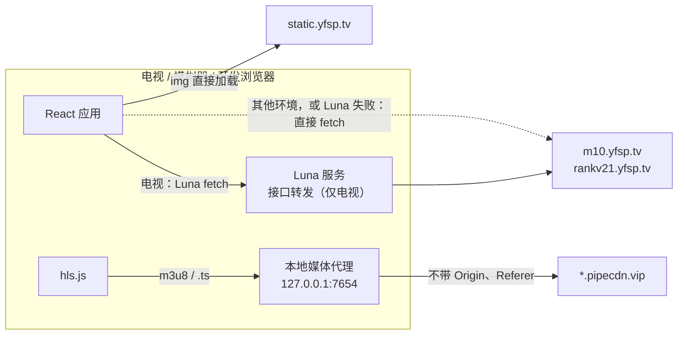

# 数据通道

接口和媒体走两条路，选路只在 `app/src/api/luna.js` 里发生一次，业务层不知道自己跑在哪个环境。

## 接口

网关对任意 Origin 都回显 `Access-Control-Allow-Origin`，不要 cookie、token 和 Referer，所以浏览器和模拟器直连就行。电视上还是先走 Luna 服务的 `fetch` 方法：打包后的 webview 跑在 `file://` 下，参考实现在真机上直连不通，yfsp 这边还没在真机上验证（架构文档 Q4），所以保留这条路，失败了再退直连。服务的接口白名单只有 `m10.yfsp.tv` 和 `rankv21.yfsp.tv` 两个主机。

GET 由 `transportGet()` 发，POST（只有搜索）由 `transportPost()` 发，body 是 `application/x-www-form-urlencoded`，属于 CORS 简单请求，没有预检。签名、超时、重试和错误码映射在 `app/src/source/yfspHttp.js`，见 [签名与请求信封](sign.md)。

## 媒体

视频 CDN 在 Cloudflare 后面，规则是「Origin 和 Referer 可以不带，带了就必须是 yfsp 自家域名」，否则回 520；User-Agent 是 `curl/*` 或 `python-requests/*` 时回 403。hls.js 用 XHR 拉流，浏览器一定会带上 Origin（电视上是 `null`，开发时是 `http://localhost:5173`），JS 改不掉这个头，所以三个环境都要经过代理。

代理就是 `service/com.yfsp.app.service/service.js` 里的 HTTP 服务，`/proxy/{host}/{path}?{query}` 转发到 `https://{host}/{path}?{query}`：

- 出站不带 Origin、Referer、Cookie，User-Agent 固定成 webOS 的 Chrome UA；
- 透传 `Range`，出站 `Accept-Encoding: identity`，因为代理按字节转发；
- 回写状态码、`Content-Type`、`Content-Length`、`Content-Range`、`Accept-Ranges`，加 `ACAO: *`；上游的 403、520 原样回给播放器，播放器靠 403 判断令牌过期；
- m3u8 不改写：分片是相对路径，经代理加载的播放列表里的分片自然也走代理；
- 白名单：CDN 域名是随机生成、会轮换的 `.vip` 域名，所以按后缀放行（`.vip`、`.yfsp.tv`、`.global-cdn.me`），并且路径必须以 `.m3u8` 或 `.ts` 结尾。校验用 `new URL()` 解析后的 `hostname`，带 `username` / `password` 的地址直接拒绝（按字符串截 host 会被 `pipecdn.vip:x@example.com` 绕过）。代理只监听 127.0.0.1。

图片 CDN 没有防盗链、带 `ACAO: *`，`` 直接加载，不进代理。

## 找到代理

`initTvEnv()` 在首帧前执行一次（`app/src/main.jsx`）：

1. 电视上先通过 Luna 调用服务的 `ping`，拿到代理实际监听的端口（端口被占用时会自增），同时确认服务可用于接口转发；
2. Luna 不通（浏览器、模拟器、服务没起来），就请求 `http://127.0.0.1:7654/ping`。这个响应带 `ACAO: *`，开发页面在 `localhost:5173` 跨源也能读到；
3. 都不通就没有代理：列表、详情照常，视频播不了。

之后 `mediaUrl()` 只要拿到了端口就把地址改写到代理上。

## 服务

服务是 Node 16、CommonJS，只用内置模块。它会注册一个 keepAlive activity，免得空闲时被 webOS 回收；日志写在 `/tmp/yfsp-service.log`；`uncaughtException` 只记日志，一个坏响应不会拖垮代理。开发机上没有 `webos-service` 模块，`npm run proxy` 启动时只起代理，固定监听 7654。
