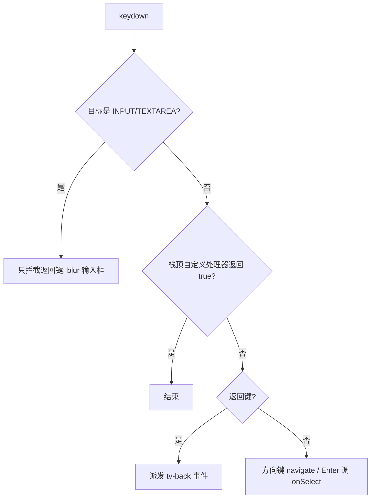

# 遥控器焦点引擎

TV 上没有鼠标和触屏，几乎所有交互都靠遥控器的方向键、OK 和返回键。整套焦点逻辑集中在 `app/src/hooks/useFocus.js` 一个文件里：模块级单例状态，React 组件只负责往里注册和注销。

## 为什么不用 React state 管焦点

电视的 SoC 很弱。如果把"当前焦点"放进 state，每按一次方向键都会触发一整片卡片网格重渲染，长按时明显掉帧。所以焦点移动完全绕开 React：`applyFocus()` 是唯一改变视觉焦点的地方，它只做三件事——摘掉旧元素的 `.focused` class、给新元素加上、再滚动到可见。全程不调 `setState`。

样式侧配合这个 class：`app/src/styles/index.css` 里的 `focused:` 自定义 variant 和 `focusable` utility 都是匹配 `.focused` 的，所以组件写 Tailwind 就能表达焦点态，不需要知道当前谁有焦点。

`useFocusable()` 返回的 `isFocused` 只是渲染那一刻的快照，不会随焦点变化更新，别拿它驱动 UI。确实需要跟踪焦点的逻辑（比如顶部 tab 栏的滑动光标 `app/src/hooks/useSlidingCursor.js`）用 `onFocusChange(fn)` 订阅。

## 寻址和注册

每个可聚焦元素的 id 形如 `{layer}/{group}-{row}-{col}`，同时写在 DOM 的 `data-focus-id` 上：

- layer：焦点层，一个页面或浮层一层，如 `home`、`detail`、`player`、`filter`、`confirm`、`keyboard`
- group：层内的一块可导航区域，如 `tabbar`、`content:home`
- row / col：整数坐标，导航就是对它们做加减

组件这样接入（以 `app/src/components/VideoCard.jsx` 为例）：

```jsx
const { props } = useFocusable({ layer, group, row, col, onSelect })
return <div {...props} className="focusable ...">...</div>
```

`props` 里有 `ref`、`data-focus-id`、`onClick`、`onMouseEnter`。注册发生在 `useEffect`，依赖只有 id 和坐标；`onSelect` / `onFocusChange` 放在 ref 里转调，父组件每次渲染传进新的回调也不会触发重新注册。

两个容易误改的细节：

- 注销时故意不清空 `currentFocusId`。聚焦中的元素可能短暂卸载再挂载（重渲染、StrictMode），保留 id 才能在重新注册后接上。真正被删掉的格子，由 `navigate()` 的失效兜底处理：发现当前焦点不在注册表或不在活动层时，落到该层记忆的格子或第一个格子。
- 每次提交后 `useLayoutEffect` 会重新校正 `.focused`。React 重写 `className` 时可能把命令式加上的 class 冲掉，keyed 节点移动时也可能把它带到错误的元素上。

## 方向键怎么走



`navigate()` 只在栈顶那一层里移动，查找靠 `Map.has()` 探测，不遍历注册表：

- 左右：同组同行 `col ± 1`，不存在就不动，不会跨组。
- 上下：默认保持当前列，目标行没有这一列时向两侧就近探测（上限 `PROBE_LIMIT = 32`），这样在网格里能沿一列直上直下。
- 几何模式：首页的各行货架、搜索页和分类页的标签条都是各自横向滚动的，同一个列号在屏幕上可能差得很远。`app/src/pages/HomePage.jsx`、`SearchPage.jsx` 和 `CategoryPage.jsx` 都用 `setGeometryVerticalGroup()` 把自己的 group 标记为几何模式，上下移动时改为在相邻行里挑水平中心离当前卡片最近的那张（`geometryColInRow()`）。
- 跨组：只在纵向撞到组边界时发生。内容区最上一行按上进入 `tabbar`，`tabbar` 按下回到当前 tab 的内容组，并恢复该组上次停留的格子。每个 tab 的内容用独立 group `content:{tabKey}`（`app/src/App.jsx` 的 `contentGroup()`），所以所有 tab 可以同时挂载而 id 不冲突；切 tab 时 `App.jsx` 调 `setActiveContentGroup()` 把这座"桥"指向当前 tab。

`setRowCursorGroup()` 是另一种"每行独立记忆列"的模式，目前没有页面在用，首页已改为几何模式。

## 焦点层和返回链

详情页、筛选面板和各种对话框挂载时调用 `useFocusFrame({ layer, focus, onKey, onBack })`，打开一个模态帧：焦点层、初始焦点、按键处理和返回键行为作为一个整体入栈，卸载时按身份移除这一帧——即使它上面还有后开的帧也不会弹错。打开时记下离开的焦点，关闭时如果它是活动层，就恢复到下面那层原来的格子，格子没了就落到该层第一个。`focus` 指定的 id 还没注册时（数据还在加载），浮层在子元素挂载后再 `focusTo()`。

只有栈顶帧的 `onKey` 能收到按键，返回 `true` 表示已消费；没消费的返回键交给栈顶帧的 `onBack`，都没有才变成 `tv-back`。之所以是栈而不是单个槽位，是因为对话框可能叠在本身就有处理器的页面上（如账号页的数字键），对话框关闭后按键要还给下面那层。筛选面板就用 `onKey` 把方向键接管过来，在网格排布的选项之间按几何位置移动；播放器用它接管全部按键，包括媒体键。返回键的判定统一用导出的 `isBackKey(e)`。

返回键统一变成 `window` 上的 `tv-back` 事件，由 `App.jsx` 处理：页面栈多于一层就弹出顶层（浮层卸载时顺带 pop 焦点层）；已在根页面且焦点在内容区，就把焦点送回 tab 栏的当前 tab；焦点已经在 tab 栏，就调 `exitApp()` 交给系统。

webOS 遥控器的返回键是 keyCode 461，不是 Backspace。浏览器里调试时 Backspace 和 Escape 也当返回键用。

## 文本输入框

输入框（`app/src/pages/SearchPage.jsx`、`app/src/pages/AccountPage.jsx`）是真正的 `<input>`：在搜索框上按 OK 时由 `onSelect` 调 `input.focus()`，系统虚拟键盘弹出。此后只要 DOM 焦点在 INPUT / TEXTAREA 上，引擎就把按键全部让给输入框：方向键移动光标（在电视上其实被虚拟键盘先吃掉了），Backspace 删字，Enter 由输入框自己的 `onKeyDown` 提交。唯一的例外是返回键，引擎把它拦下来让输入框 `blur()`，回到方向键导航，而不是触发整条返回链。这个状态下 Backspace 绝不能当返回键处理。

## Magic Remote 指针

LG 的 Magic Remote 可以当鼠标用。`useFocusable` 给元素挂了 `onMouseEnter`，指针悬停只移动焦点、不触发选择；点击才会先 `setFocus` 再调 `onSelect`。所以指针和方向键共用同一个焦点，切换输入方式时不会出现两个高亮。

指针（悬停或点击）引起的焦点移动只把被裁掉的部分滚进来，不留方向键用的边距（不用滚动容器的 scroll-padding，也不用 `STRIP_SAFE`），标签页只让开顶部 84px 的标签栏：元素刚好在页面滚动容器和横向带里完整露出，并且仍在指针下面。如果按方向键的规则留边距，下一排或下一张卡片会滑到没动过的指针下面，又抢走焦点，页面就会一路自己滚到底。侧边面板和对话框不是页面滚动容器，悬停不会纵向滚动它们，用遥控器滚轮翻。

## 滚动

焦点移动后的滚动是整个应用唯一的滚动动画。CSS 里全局禁用了 transition 和 animation，但这条禁令不管 `scroll-behavior`，属于有意保留的例外。

- 平滑滚动设置：设置页的"平滑滚动"对应 `smoothScroll`（默认开，见 `app/src/store/settings.js`），关掉后所有焦点滚动都变成瞬时的 `auto`。
- 快速连按：长按方向键时，自动重复的间隔（约 100–150ms）比原生平滑滚动的固定动画时长还短，每次按键都从一个没追上的位置重新起动画，结果光标跑出屏幕、松手后画面才追上来。所以两次焦点滚动间隔小于 `RAPID_MS = 220` 时强制用瞬时滚动，慢速单步仍然平滑。长按本身另有处理：遥控器的自动重复（`e.repeat`）节流到每 `REPEAT_MS = 120` 毫秒最多走一步，避免按键积压；长按期间的每一步都用瞬时滚动，包括松开初始延迟后的第一次重复，否则它会起一段平滑动画，又被下一次重复截断。
- 第 0 行特殊处理：tab 栏以外的第 0 行通常是一条横向滚动带（类型标签、首页第一排货架）。这里分别驱动两个滚动容器：把外层 `.tab-content` / `.overlay` 滚到顶部，让标题露出来；再用 `scrollStripIntoView()` 直接滚动横向带。不能用 `scrollIntoView` 加 `scrollTo` 的组合，因为对外层容器调 `scrollTo` 会打断横向带正在进行的平滑滚动，表现为第一行慢速左右移动时完全不滚。侧边面板、对话框和播放器的第 0 行（筛选面板的地区、键盘的第一排键、播放器选集条）不在这类页面容器里滚动，走下面的 `scrollIntoView` 兜底，滚的是面板或选集条自己。
- 其余行同样分别驱动两个容器，不用 `scrollIntoView`：`scrollPageIntoView()` 只滚元素所在的 `.tab-content` / `.overlay`，`scrollStripIntoView()` 只滚横向带。原因是性能：Chromium 把 `scrollIntoView` 当作"序列化"滚动，平滑动画只能在主线程逐帧推进，主线程一忙就卡；对已合成的滚动容器直接 `scrollBy`，动画在合成器线程上跑。`.tab-content`、货架横条和详情页 `.overlay` 都带 `bg-bg will-change-scroll`，保证它们是合成滚动容器。元素不随这类容器滚动时（例如 DOM 挂在 `.tab-content` 里的 fixed 面板：屏幕键盘、对话框），`scrollPageIntoView()` 沿 `offsetParent` 链找不到该容器，就退回 `scrollIntoView`。
- 边距：横向滚动带（货架、类型标签、搜索词条）出血到屏幕边：容器用 `-mx-safe` 撑满 0–1920，`pl-safe` 让第一项仍停在 x=84，末尾再放一个占位块，它和前面的间距加起来正好 84。所以 `STRIP_SAFE = 84` 是从屏幕边算起的安全边距，获得焦点的卡片正好停在列线上，越过第 6 张后每步正好滚一列；6 张卡片的货架内容正好 1920 宽，不会滚动。末尾用占位块而不用右内边距，是因为旧版 Chromium 的 flex 滚动容器可能不把末尾内边距算进可滚动范围。横向安全边距同时放在元素的 `scroll-margin-inline` 上（退回 `scrollIntoView` 时用），`STRIP_SAFE` 与之对应，改一处要同步另一处。纵向边距放在滚动容器的 `scroll-padding` 上（`scroll-py-focus-safe`），`scrollPageIntoView()` 读取容器计算后的 `scroll-padding` 作为边距，所以只需改 CSS。之所以不放在元素的 `scroll-margin` 上，是因为退回 `scrollIntoView` 时，它会从内往外逐层裁剪目标矩形：货架卡片外面套着一个和卡片等高的横向滚动容器，元素上的纵向 margin 在传到页面滚动容器之前就被丢掉了，卡片会停在 tab 栏下面。详见 `app/src/styles/index.css` 中 `[data-focus-id]` 规则的注释。

## 改动时注意

- 新的可聚焦元素必须走 `useFocusable` 并展开 `props`，否则 `applyFocus` 找不到 DOM 节点。
- 同一层同一组内坐标不能重复；列号要从 0 连续编号，几何模式和就近探测都依赖这一点。
- 新浮层记得成对调用 push/pop（焦点层和按键处理器各一对），并在 cleanup 里释放。
- 想在焦点变化时更新 React 状态，先确认真的需要；需要的话用 `onFocusChange` 订阅，不要在 `useFocusable` 的回调里批量 `setState`。
