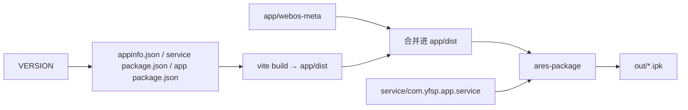

# 打包与发布

这份文档讲清楚源码怎么变成一个能装到 LG 电视上的 `.ipk`：本地怎么打包，打 tag 后 CI 怎么发版，以及怎么把包装进开发者模式下的电视并调试。

## 一条命令打包

```bash
bash build.sh                  # 本地打包，版本号用占位的 1.0.0
VERSION=1.0.2 bash build.sh    # 发版工作流实际执行的命令
```

`ares-*` 系列命令来自 `app/` 的开发依赖 `@webos-tools/cli`，所以在 `app/` 里跑一次 `npm ci` 就具备了全部打包条件，不需要全局安装 LG 的 CLI。产物统一放在仓库根目录的 `out/`。

`build.sh` 按顺序做四件事：

1. **同步版本号。** 用一段内联 Node 脚本把 `VERSION` 写进 `app/webos-meta/appinfo.json` 和 `service/com.yfsp.app.service/package.json`，再在 `app/` 里执行 `npm version "$VERSION" --no-git-tag-version --allow-same-version`，顺带让 `package-lock.json` 保持一致。
2. **构建前端。** `app/` 里执行 `npm run build`（即 `vite build`），输出到 `app/dist/`。
3. **合并 webOS 元数据。** `cp -r app/webos-meta/. app/dist/`，把 `appinfo.json` 和两个图标放到构建产物根目录；再把仓库根目录的 `THIRD_PARTY_NOTICES.md`（界面图标 Material Symbols 的 Apache 2.0 许可）一起拷进去，随包分发。
4. **打包。** `ares-package --no-minify app/dist service/com.yfsp.app.service -o out`，把前端和 Luna 服务装进同一个 `.ipk`，文件名形如 `out/com.yfsp.app_1.0.2_all.ipk`。



### 为什么版本号要先同步

仓库里 `appinfo.json`、`app/package.json`、服务的 `package.json` 三处的 `version` 都是占位值 `1.0.0`，真正的版本只存在于 git tag 上。打包前统一写入，是为了让三个地方显示的版本永远一致：`.ipk` 文件名（取自 `appinfo.json`）、电视系统里看到的应用版本、以及设置页列表下方的「版本」标签。最后这个标签来自 `app/vite.config.js` 里的 `define: { __APP_VERSION__: ... }`，它在构建时读取 `app/package.json` 的 `version`，在 `app/src/pages/SettingsPage.jsx` 中渲染。

所以本地跑 `build.sh` 会改动这几个文件的 `version` 字段。用默认的 `1.0.0` 时内容不变；如果本地传了别的 `VERSION`，提交前记得改回去，别把真实版本号提交进仓库。

### Vite 配置的两个关键点

见 `app/vite.config.js`：

- `build.target: 'chrome108'`。webOS 24 内置的是 Chromium 108，更新的 JS/CSS 语法在电视上会直接失效，而且往往没有任何报错，所以构建目标必须钉死。
- `base: './'`。`.ipk` 里的页面是通过 `file://` 加载的，资源路径必须是相对路径，绝对路径 `/assets/...` 在电视上会全部 404。

另外 hls.js 和 React 通过 `manualChunks` 拆成独立 chunk，播放器代码是懒加载的，不进启动包。

## appinfo.json

`app/webos-meta/appinfo.json` 是 webOS 识别应用的清单，几个值得留意的字段：

| 字段 | 值 | 说明 |
| --- | --- | --- |
| `id` | `com.yfsp.app` | 应用 ID；服务 ID `com.yfsp.app.service` 必须以它为前缀，否则打包会失败 |
| `type` / `main` | `web` / `index.html` | Web 应用，入口是 Vite 产出的 `index.html` |
| `version` | `1.0.0` | 占位值，由 `build.sh` 覆盖 |
| `uiRevision` | `2` | 使用新版系统 UI 行为 |
| `resolution` | `1920x1080` | 按 1080p 画布布局 |
| `disableBackHistoryAPI` | `true` | 不加的话，遥控器返回键会直接退出应用 |
| `requiredPermissions` | `["all"]` | 申请全部权限 |
| `requiredACG` | `[]` | 显式声明为空列表 |
| `icon` / `largeIcon` | `icon.png` / `largeIcon.png` | 80x80 和 130x130，必须是真正的 PNG 文件 |

`disableBackHistoryAPI: true` 打开后，返回键会作为 keyCode 461 交给页面，由应用自己的返回链处理，例如各个弹层里的 `e.keyCode === 461` 判断（`app/src/components/ConfirmDialog.jsx` 等）。

## 打 tag 发版

发版由 `.github/workflows/release.yml` 完成，推送 `v*` 格式的 tag 时触发：

```bash
git tag v1.0.2 && git push origin v1.0.2
```

工作流在 Ubuntu 上用 Node 22 执行 `npm ci`，然后去掉 tag 前缀的 `v` 作为 `VERSION` 运行 `build.sh`，最后用 `gh release create` 把 `out/` 里的产物发布成 GitHub Release，说明由 `--generate-notes` 根据上一个 tag 以来的提交自动生成。tag 里带连字符的（如 `v1.1.0-beta.1`）会被标成预发布。

整个过程不会把版本号写回源码树：CI 里 `build.sh` 改动的文件只存在于那次运行的工作区，仓库里始终是占位值。

除了 `.ipk`，`build.sh` 还会在 `out/` 生成一份 `com.yfsp.app.manifest.json`，随 `.ipk` 一起上传到 Release。它是 webOS Homebrew Channel 风格的仓库清单，包含 `id`、`version`、`type`、`title`、`iconUri`、`sourceUrl`、`rootRequired: false`、`ipkUrl`、`ipkSize` 和 `ipkHash.sha256`，供第三方应用商店据此发现并校验安装包。

## 装到电视上

电视需要先安装 LG 的 Developer Mode 应用并开启开发者模式。以下命令都可以通过 `app/node_modules/.bin/` 或 `npx` 调用。

1. 注册设备：`ares-setup-device` 按提示添加电视的 IP，端口 9922，用户 `prisoner`。
2. 取私钥：`ares-novacom --device <设备名> --getkey`，过程中输入 Developer Mode 应用里显示的 passphrase。
3. 安装：`ares-install --device <设备名> out/com.yfsp.app_<版本>_all.ipk`。
4. 启动：`ares-launch --device <设备名> com.yfsp.app`。

设备地址、passphrase、私钥只放在本机的 ares 配置里，不要写进仓库；`.gitignore` 已经排除了 `.env`、`*.pem`、`tv-key*` 等文件。

## 调试

`ares-inspect --device <设备名> --app com.yfsp.app` 会在电视上打开远程调试端口，并给出一个可以用桌面 Chrome DevTools 连接的地址，Console、Network、Elements 都能用。服务端的 Node 代码可以用 `ares-inspect --device <设备名> --service com.yfsp.app.service` 连上。

日常界面开发不必每次都装到电视：浏览器里的 `npm run dev` 足够覆盖大部分交互，需要更贴近真机时可以用 `npm run sim`，它构建并合并元数据后，用 `ares-launch -s 26` 在本机的 webOS 模拟器里启动 `dist/`。注意 `-sp /Applications` 是写死的模拟器安装路径，装在别处需要自行调整。

## 注意事项

- Developer Mode 有效期有限，到期后已安装的开发者应用会被清除；passphrase 也会变化。SSH 认证失败时，先回电视上的 Developer Mode 应用续期，再重新执行 `--getkey`。
- 改了 `app/webos-meta/` 下的东西不需要改 Vite 配置，`build.sh` 第 3 步会原样复制整个目录。
- `ares-package` 用了 `--no-minify`：前端代码已经由 Vite 压缩过，不需要 ares 再处理一遍。
