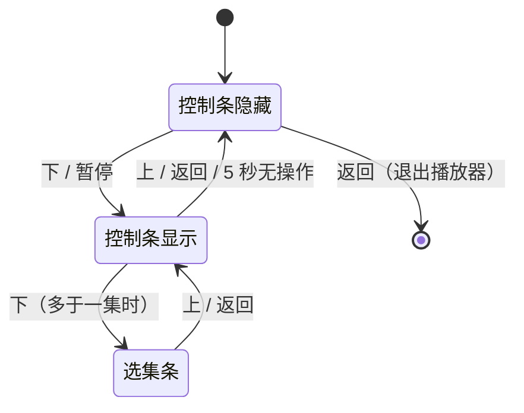

# 播放器

播放器分两个文件：`app/src/player/PlayerPage.jsx` 负责全屏 `<video>`、按键状态机、自动下一集和错误页，决定播哪一集、从哪里续；`app/src/player/playbackSession.js` 不依赖 React，负责把流挂到 `<video>` 上——hls.js 初始化、续播跳转、卡顿自救和进度采样，结果通过回调交回页面。它是 `player` 焦点层，叠在详情页之上，返回键一层层往回退。

## 加载方式

`PlayerPage` 是整个应用里唯一用 `lazy()` 加载的页面（`app/src/App.jsx`），hls.js 在 `playbackSession.js` 里再用 `import('hls.js/light')` 动态引入，`app/vite.config.js` 的 `manualChunks` 把它单独切成 `hls` chunk。这样首屏包里没有任何播放器代码。

选 light 版是因为我们用不到字幕、多音轨和 DRM，完整版会超过打包器 500 kB 的告警线。

详情数据（标题、剧集列表）通过 `loadDetail(id)`（`app/src/api/feeds.js`）读，下面的详情页已经缓存过，进播放器不会重新请求。

播放地址不在详情里，每一集进播放器时现取：`resolveStream(id, episode)`（`app/src/source/yfsp.js`）用剧集 key 配 `a=0` 请求 `v3/video/play`，取可播的那一档（未登录只有「标清 576P」）。m3u8 地址带着约 48 小时的令牌，还签进了请求方的公网 IP，所以从不缓存。拿到的地址再经 `mediaUrl()`（`app/src/api/luna.js`）改写成本地代理地址：视频 CDN 拒绝任何站外 Origin，而 hls.js 一定会带，所以浏览器、模拟器和电视都要经过代理，见 [数据通道](data-channel.md)。左上角画质卡片显示这一档的名字、分辨率和码率。站点给的是不带主列表的媒体播放列表，不声明分辨率和码率，所以分辨率读 `<video>` 解码出的尺寸，码率用前三个分片的字节数除以时长估算（576 档实测约 530 kbps）。

## hls.js 优先，原生 HLS 只做兜底

不管在浏览器还是电视上，只要 `Hls.isSupported()` 就用 hls.js；只有 MSE 不可用时才退回 `video.canPlayType('application/vnd.apple.mpegurl')` 的原生管线，两者都没有就直接报 `source` 错误。

这样做的原因是 webOS 自带的 HLS 管线缓冲很浅、也调不了，播高码率 1080p 时会反复把缓冲耗干然后卡住。hls.js 可以设一个又深又有内存上限的前向缓冲（`HLS_CONFIG`）：

- `maxBufferLength: 60`、`maxMaxBufferLength: 120`：前向缓冲目标 60 秒，上限 120 秒；
- `maxBufferSize`：约 60 MB，防止小内存电视被撑爆；
- `backBufferLength: 30`：播放头后面超过 30 秒的数据及时释放。

加载策略 `LOAD_POLICY` 对 manifest、playlist、分片统一使用平坦的短重试（最多 4 次、每次间隔 200ms），不用指数退避。指数退避会把一次偶发失败拖成开播前好几秒的黑屏。

## 画质：自动，但封顶在 1440p 以下

hls.js 以 `autoStartLoad: false` 创建，等 `MANIFEST_PARSED` 拿到全部 level 后，`pickStartLevel()` 选出高度小于 1440 的最高档（同高度比码率），同时设为 `startLevel` 和 `autoLevelCapping`，ABR 之后只在这一档及以下浮动。UHD 档对电视解码和带宽都太重，不让它自动选上。如果 master 里没有 1440p 以下的档，就不干预，交给 hls.js 自己的 ABR。

没有手动切换画质的入口，也没有倍速，`playbackRate` 始终是 1。

左上角标题卡片里，片名下面有一行小字显示画质，内容来自 `LEVEL_SWITCHED` 事件里当前 level 的宽高和声明码率，格式如 `1920 × 1080 · 5.2 Mbps`（`fmtTrack()`）。这里是 level 的标称码率，不是实测带宽。原生兜底路径没有 level 信息，只能从 `resize` 事件取画面尺寸；什么都不知道时整行不显示，不放占位符。

## 续播规则

续播策略集中在 `app/src/store/watchState.js`，播放器、详情页和首页都从它拿答案：

| 常量 | 位置 | 值 | 含义 |
| --- | --- | --- | --- |
| `RESUME_MIN_S` | `watchState.js` | 30 | 看过超过 30 秒才续播 |
| `FINISHED_TAIL_S` | `watchState.js` | 15 | 离结尾 15 秒以内算看完 |
| `PROGRESS_FLUSH_MS` | `playbackSession.js` | 5000 | 播放中每 5 秒写一次进度 |

进入时用 `resumePosition(getWatchState(id), curEp)` 算断点，只有同一集、`position > 30` 且没有 `finished` 标记时才续播。hls.js 路径直接 `hls.startLoad(resumePos)` 从断点开始加载，避免先从 0 加载再跳转造成双份缓冲；原生路径在 `loadedmetadata` 里跳。第一次 `playing` 时如果发现位置比断点早 3 秒以上（hls.js 偶尔会把首帧拉回 0），再纠正一次。开播后右上角弹 3 秒提示「已从 mm:ss 继续播放」。

写入：首次 `playing` 调 `recordHistory()`，之后播放会话每 5 秒在非暂停状态下交回一次位置，页面调 `recordProgress()`；会话销毁时（退出、重试、换集）也会 flush 一次。记成什么由 `progressEntry()` 决定，看完的处理分两种：

- 还有下一集：断点直接挪到下一集的 0 秒；
- 已是最后一集：保留当前集、位置记在结尾、`finished: true`。保留而不清空，是为了这部剧以后更新了新集还能接着续；续播判断里会跳过 `finished`，不会续到片尾。

一个容易踩的坑：flush 用的位置来自 `timeupdate` 记下的 `lastKnown`，不在 flush 时现读 `currentTime`。电视原生管线在挂起或销毁过程中 `currentTime` 可能已经是 0，现读会把真实进度覆盖掉。同理，播放中途突然出现的 `currentTime === 0` 被当作管线重置，不更新 `lastKnown`。

## 不可跳转的片源

`canSeek()` 要求 `duration` 是有限正数并且 `video.seekable` 非空。不满足时所有快进快退都直接忽略；有断点的话也只能从头播，提示改成「此片源不支持跳转，已从头播放」，免得用户以为进度丢了。这个判断在 `durationchange` 和 `playing` 时都会重新做，而且续播逻辑用的是实时判断，不读 React 状态，因为此时状态还没来得及重新渲染。

## 按键状态机

所有按键都在播放器自己的按键处理器里统一拦截（`app/src/hooks/useFocus.js`），不交给焦点引擎的默认导航。

- 控制条隐藏：左右快退快进，OK 播放/暂停，上键重新显示按键提示，返回退出。
- 控制条显示：左右同样快退快进，OK 播放/暂停，上和返回都是收起控制条。
- 选集条打开：左右和 OK 交给焦点引擎处理（移动高亮、横向滚动、选中），其他键吞掉。
- 加载中：吞掉方向键和 OK，防止漏到下面的详情层；返回键照常退出。
- 错误页：恢复普通焦点导航，用来操作「重试」等按钮。

控制条显示后 5 秒无输入自动隐藏，但暂停时不隐藏，计时器每 5 秒复查一次。进度条、时间码、缓冲宽度都在 `timeupdate` / `progress` 事件里通过 ref 直接改 DOM，控制条本身始终挂载、只切 `display`，播放过程中组件不会每秒重新渲染。

## 跳转累积与长按加速

`stepSeek()` 不会每按一下就真的跳。每次按键把偏移累加到 `pendingSeekRef`，屏幕中下方显示目标时间徽标（快退 / 快进图标加时间），控制条显示时进度条也会跟着预览；按键停下 500ms 后才写一次 `currentTime`，徽标再停留 800ms 后消失。这样连按十下只会产生一次分片请求。

单击一次 15 秒（`STEP_S`）。长按依赖系统按键重复，节流到每 200ms 一步，倍率是「已按住秒数 × 4」，不设上限：第一秒内 1 倍，按住 1 秒后 4 倍（每步 60 秒），2 秒后 8 倍，依此类推。重新按下会把倍率重置。目标位置被限制在 `[0, duration - 2]`。

## 遥控器媒体键

`mediaKey()` 同时认 webOS keyCode（415 播放、19 暂停、413 停止、417 快进、412 快退）和浏览器的 `MediaPlay` 等键名。媒体键在任何状态下都优先处理，也不会移动焦点：

- 快进快退一次 30 秒（`MEDIA_STEP_S`），同样走累积和长按加速；只显示徽标，不唤出控制条；
- 播放、暂停、播放暂停合一键各自对应；
- 停止键派发 `tv-back`，等同退出播放器。

## 选集条

在控制条上再按下键打开（只有一集时不响应），控制条随之上移。条里的每一格都是 `episodes` 分组里的真实 focusable，滚动和高亮由焦点引擎负责。打开时先用 `behavior: 'auto'` 把当前集瞬间滚进视野，再 `focusTo`，所以打开是直接到位，之后移动才有动画。

顺序跟随用户在详情页选的正序/倒序（`episodeOrderStore`）。注意 `epList` 本身始终保持接口给的「新的在前」顺序，「下一集」由 `nextEpisode()` 按集号推出（比当前集号大的最小那一集），和显示顺序无关；选集条只渲染一份反转后的副本，光标下标也要相应镜像。

在选集条里按 OK 会换集但保持控制条和选集条都显示，可以连续挑；此时全屏的加载遮罩被压住，新的流在选集条后面加载。

## 下一集提示与自动连播

剩余不到 30 秒（`UP_NEXT_S`）且有下一集时，右下角出现「即将播放」卡片。卡片显示期间 OK 立即切到下一集，上或返回关闭卡片，本集内不会再出现；其他键保持原本作用。选集条打开时 OK 归选集条，卡片先隐藏，收起选集条后再出现。

`ended` 时先 flush 进度，有下一集就原地换集（`switchEpisode()`，不退出播放器，重新走一遍选档流程），加载时显示「正在加载 第N集…」；最后一集播完则派发 `tv-back` 回到详情页，焦点在详情层恢复。

## 错误分类与令牌过期

失败按原因分开提示，不笼统写「加载失败」（`ERROR_TEXT`）：

- 取址失败：网关返回的业务错误（`ApiError`）算片源不可用，code 5（网关要求人机验证，电视上过不了）单独提示「访问受限，请稍后再试」，其余算网络；
- hls.js 致命错误按类型分：`NETWORK_ERROR` 是网络，`MEDIA_ERROR` 是解码，其余算片源；
- 原生路径看 `MediaError.code`：2 网络、3 解码、4 及其他算片源；
- VIP 集：没有登录，播不了，提示「这一集需要爱壹帆会员」。详情页进入时已经拦过，但自动连播仍可能落到一集 VIP 上，所以播放器自己也要处理。

令牌过期：m3u8 和分片地址里的令牌有时效，过期后 CDN 回 403。hls.js 的致命网络错误带着 HTTP 状态码（`response.code`），`fatalAction()`（`playbackSession.js`）判断：第一次 403 时调页面的 `onExpired`，页面重新 `resolveStream`，再用 `reload(newSrc)` 换上新地址，从原来的位置接着播；换址后到恢复播放前又遇到 403，才按网络错误进错误页。单次 403 会先被 hls.js 自己的重试吃掉，只有一直 403 才会走到这里。

「重试」通过递增 `attempt` 拆掉整条播放管线重建，会重新取址。

## 卡顿看门狗

开播后每秒检查一次 `currentTime` 是否在前进（变化小于 0.25 秒算冻结）。暂停、结束、正在 seek 或有待提交的跳转时不计时。它会区分正常的重新缓冲：只要缓冲区还在增长就不打扰，除非冻结已超过 15 秒（视为解码器死锁）。处理按阶梯升级：

1. 冻结 3 秒（仅原生路径）：缓冲区里前方 1 秒内有空洞就跳过去，否则在有数据的前提下往前挪 0.1 秒踢一下解码器。hls.js 有自己的 gap controller，再叠一层会互相打架，所以 hls.js 路径跳过这一步；
2. 冻结 8 秒：软重载。hls.js 用 `startLoad(pos)` 原地重新拉取；原生路径重设 `src`，等 `loadedmetadata` 后跳回原位置。不会闪加载页；
3. 连续 3 次软重载仍不行，进入错误页。连续正常播放 30 秒后计数清零。

看门狗触发的错误页没有设置 `errorKind`，会落到默认的「片源暂不可用」文案。

## 按键提示

没有任何观看进度的标题，每次进入都会在顶部显示 6 秒的「遥控键位」卡片（按键、作用两列对照），不是只显示一次的开关；记录过进度后就不再自动出现。控制条隐藏时按上键可随时唤出。任意键都会关掉它，同时照常执行该键的作用。
