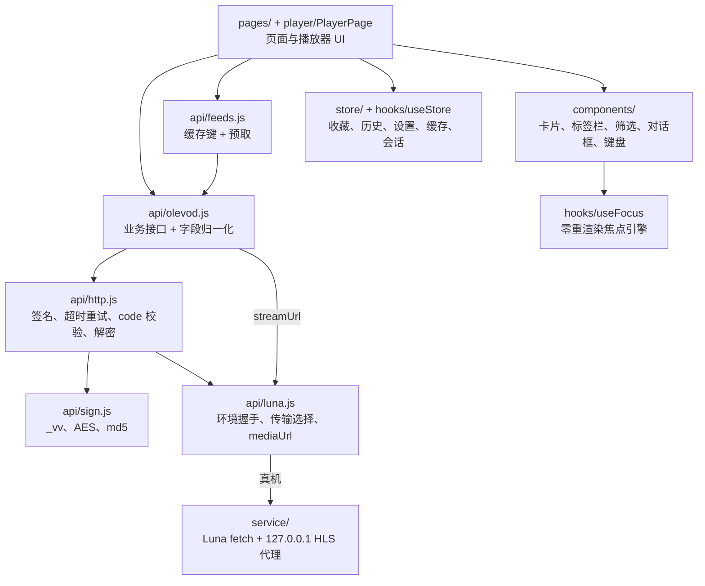

# olevod 复用地图

这份文档是给 yfsp-webos 架构文档打底用的：把参考实现 olevod（`/Users/chenshi/Developer/olevod`，下文路径都相对这个仓库）逐个文件过一遍，说清楚哪些能原样搬、哪些要改、哪些得重写，再从现有页面实际用到的字段倒推出一套与数据源无关的领域模型。

结论先放前面：olevod 的数据源耦合集中在 `app/src/api/` 和 Luna 服务的白名单/请求头这两处，外加几个页面里对字段名和 VIP 规则的直接引用。焦点引擎、存储、播放会话、组件库基本与数据源无关，可以整体搬过来。真正要动脑子的地方有三个：

1. olevod 的剧集播放地址是随详情一起返回的（`detail().episodes[].url`），yfsp 大概率要按集单独请求播放信息，详情页和播放器的取源流程要从“读字段”改成“调一次 `resolveStream()`”。
2. olevod 的登录靠 4 位图片验证码，yfsp 主包里出现的是 Cloudflare Turnstile 和 Google reCAPTCHA，电视上几乎不可能完成。MVP 建议整块去掉账号，VIP 规则降级为“提示不可播”。
3. 签名、解密、图片尺寸规则都是 olevod 网关专有的，yfsp 的对应物要等抓包调研的结论，这里只留接口位置。

## 一、olevod 的分层



几个值得保留的约定：

- `luna.js` 是全应用唯一碰 `fetch`、`PalmSystem`、`PalmServiceBridge` 的文件，业务层不知道自己在电视还是浏览器里。
- `http.js` 是唯一的取数入口，返回解包、解密后的 `data`；GET 3 秒超时、重试 3 次、每次重新签名；POST 不重试。
- `feeds.js` 独占 `pageCache` 的键，页面只按参数加载/失效，看不到键；启动后顺序预取（并发签名请求会互相拖慢）。
- 页面之间只传 id，详情数据经 `loadDetail(id)` 缓存，播放器进来不重复请求。

### 1.1 api 层对页面暴露的函数

| 函数 | 位置 | 返回形状 | 调用方 |
| --- | --- | --- | --- |
| `categoryList({category, genre, area, year, letter, sort, page, size})` | olevod.js | `{ items: Summary[], total, page, size }` | feeds.js |
| `banners()` | olevod.js | `[{ id, title, pic, remarks }]` | feeds.js |
| `searchSuggest(keyword)` | olevod.js | `string[]`（去重） | SearchPage |
| `searchHotKeywords(limit)` | olevod.js | `string[]` | SearchPage |
| `searchList({keyword, page, size})` | olevod.js | `{ items: Summary[], total, page, size }` | SearchPage |
| `detail(id)` | olevod.js | `Detail`（见第三节），`episodes` 新的在前 | feeds.js |
| `imageUrl(pic, size)` | olevod.js | 完整图片 URL，`size` 如 `'384x560'` | Thumb |
| `streamUrl(url)` | olevod.js | 真机改写成 `http://127.0.0.1:{port}/proxy/...`，浏览器原样 | PlayerPage |
| `captcha()` / `login()` / `userInfo()` | olevod.js | `{id,image}` / `{token,name,userId}` / `{userId,groupId}` | AccountPage、DetailPage |
| `loadHomeBanners()` / `loadHomePopular()` / `POPULAR` | feeds.js | 缓存过的横幅、`[{key,title,category,items}]` | HomePage、SearchPage |
| `loadCategoryPage(category, filter, page)` / `invalidateCategory` | feeds.js | 同 `categoryList`，只缓存第 1 页 | CategoryPage |
| `loadDetail(id)` | feeds.js | 缓存过的 `Detail` | DetailPage、PlayerPage |
| `invalidateHome()` / `prefetchAll(shouldStop)` | feeds.js | — | HomePage、App |
| `ApiError` | http.js | `{ message, code }` | AccountPage |
| `initTvEnv()` / `exitApp()` / `isTV` | luna.js | — | main.jsx、App |

### 1.2 store 的形状

| store | localStorage 键 | 形状 |
| --- | --- | --- |
| settings | `olevod:settings` | `{ homeShowFavorites, homeShowRecent, tabOrder, hiddenTabs, smoothScroll }`，读取一律走 `getSetting` 兜底 |
| favorites | `olevod:favorites` | `Summary[]`，最新在前 |
| history | `olevod:history` | `(Summary & { watch, updatedAt })[]`，上限 40；`watch = { lastEpisodeIndex, position, duration, finished }` |
| searchHistory | `olevod:searchHistory` | `string[]`，上限 20 |
| episodeOrder | `olevod:epOrder` | `{ [id]: true }`，只记改成正序的 |
| filters（内存） | — | `{ [categoryId]: { genre, area, year, letter, sort } }`，`'0'` 表示全部 |
| pageCache（内存） | — | `Map<key, data>` + 在途 Promise 去重 |
| session（内存 + vault） | `olevod:vault:*` + IndexedDB `olevod-vault` | `{ token, name, userId } \| null` |

`createStore(key, default)` 返回 `{ get, set, subscribe }`，`useStoreValue(store, selector)` 基于 `useSyncExternalStore`，selector 只能挑不能算。

### 1.3 播放器依赖的接口

`player/playbackSession.js` 的 `createPlayback(video, opts)` 完全不依赖 React 和数据源，入参只有：

- `src`：已经过 `streamUrl()` 的 m3u8 地址；
- `resumePos`、`seekPending()`；
- 回调 `onStatus(status, kind)`、`onStart(canSeek)`、`onPaused`、`onTrack({width,height,bitrate})`、`onTime`、`onBuffered`、`onProgress(pos, dur)`、`onEnded`。

`PlayerPage.jsx` 和数据源相关的只有四处：`loadDetail(id)` 取剧集、`data.episodes.find(e => e.index === curEp).url` 取地址、`ep.vip && !sessionStore.get()` 判断要不要提示登录、`onStart` 里用 detail 字段拼 `recordHistory` 的条目。续播、下一集全部来自 `store/watchState.js`，只认 `episodes[].index`。

## 二、文件级复用地图

分类说明：原样复用是拷过来只改 `olevod` 前缀和文案；改造复用是结构保留、要换数据或字段；替换是 olevod 专有、要按 yfsp 重写或删掉。

### 2.1 前端 `app/src/`

| 文件 | 分类 | 理由与改造要点 |
| --- | --- | --- |
| `main.jsx` | 改造 | 结构不变（首帧前 `await initTvEnv()`）；MVP 不做账号就去掉 `initSession()` |
| `App.jsx` | 改造 | 视图栈、标签挂载、返回链都通用；去掉 `account` 帧和 `openAccount`（若不做账号），`prefetchAll` 依赖 session token 的那段一并简化 |
| `hooks/useFocus.js` | 原样 | 焦点引擎与数据源无关；依赖 `store/settings.js` 的 `smoothScroll`，要一起带过来 |
| `hooks/useFocus.test.js` | 原样 | |
| `hooks/useSlidingCursor.js` | 原样 | 标签栏滑动光标 |
| `hooks/useStore.js` | 原样 | `createStore` / `createMemoryStore` / `useStoreValue` |
| `config/taxonomy.js` | 改造 | 形状保留（`CATEGORIES[{id,name,genres,areas,years}]`、`SORTS`、`LETTERS`），数据按 yfsp 的分类和筛选接口重新抓取冻结。注意 `getCategory` 里 `Number(id)`，yfsp 分类 id 若是字符串要改。yfsp 若没有首字母筛选，删掉 `LETTERS` 和面板里那一组 |
| `config/nav.js` | 原样 | 从 taxonomy 推导标签，排序/隐藏逻辑与数据源无关；账号标签不做时从 `TABS` 删一行 |
| `config/nav.test.js` | 原样 | 测试里若硬编码了分类 key 要跟着改 |
| `api/luna.js` | 改造 | `SERVICE` 常量改为 `com.yfsp.app.service`；`transportGet` 的 Luna 优先、失败退直连保留。另外 `initTvEnv()` 开头的 `if (!isTV) return` 和 `mediaUrl()` 的 `isTV && serviceReady` 前置条件要去掉：yfsp 的媒体在浏览器和模拟器里也要走代理，握手失败后要能用 HTTP `/ping` 找到开发机上的代理并改写地址（架构文档第 3 节）。接口不需要特殊请求头，`directGet` 不用改 |
| `api/http.js` | 改造 | 超时重试、`withTimeout`、`ApiError`、token provider 这套骨架留下；`API_BASE`、`buildUrl`（`_vv`、`_he/_pl/_si`）、`unwrap`（`code===0`、AES 透明解密、过期码 12/13/14/16）按 yfsp 的响应信封重写。yfsp 接口有 `api8.` 和 `m10.` 等多个子域，`API_BASE` 要变成按接口选 host |
| `api/sign.js` | 替换 | `_vv` 和按日期派生 key 的 AES 是 olevod 网关专有算法。主包里也出现了 `vv`，yfsp 是否同一套要靠调研核实；就算相同也应在新项目里独立写一份并配 `node --test` 向量。`md5` 实现可以拷 |
| `api/olevod.js` | 替换 | 改名为 `source/yfsp.js`（见第四节），按适配器契约输出领域模型。可借鉴的是写法：每个接口一段注释写清路径和响应怪癖，归一化集中在一处 |
| `api/feeds.js` | 改造 | 缓存键、`loadOnce` 去重、顺序预取都留下；`POPULAR` 里的 `category` 换成 yfsp 的分类 id，或者直接用 yfsp 首页接口给的分区（首页 HTML 内联 JSON 里像是有现成的分区数据）；import 从 `olevod.js` 改为适配器 |
| `store/settings.js` | 原样 | 键名前缀改 `yfsp:` |
| `store/favorites.js` | 原样 | 同上 |
| `store/history.js` | 原样 | 同上；条目形状就是 Summary 加 `watch`、`updatedAt` |
| `store/watchState.js` + test | 原样 | 只认 `episodes[].index`，前提是适配器给每集一个从 1 开始的整数 `index` |
| `store/episodeOrder.js` | 原样 | 前提同上：适配器输出“新的在前”的顺序，或者统一改成升序并调整 DetailPage 的反转逻辑，二选一要在架构文档里定死 |
| `store/filters.js` + test | 改造 | import 了 taxonomy 的 `DEFAULT_LETTER`，`DEFAULT_FILTER` 带 `letter`；yfsp 没有首字母，要去掉 `letter` 并换成新维度 |
| `store/pageCache.js` + test | 原样 | |
| `store/searchHistory.js` | 原样 | |
| `store/session.js` | 替换（MVP 删除） | 与 olevod 的 token 三段式和 http.js 的注入点绑定。yfsp 登录需人机验证，MVP 不做 |
| `store/vault.js` | 原样（暂不用） | 通用的 WebCrypto 加密槽位，将来真要存凭据再拷 |
| `components/VideoCard.jsx` | 改造 | 用到 `item.{id,name,pic,picThumb,score,remarks,year}`；UHD 角标靠正则匹配 `remarks` 里的 `4k/uhd/蓝光`，换源后看 yfsp 有没有对应标记，可以改为读 Summary 上的显式字段。yfsp 的 `remarks` 是 `lastName`（「22」「18集全」），正则永远不会命中，要改读 `uhd`；`picThumb` 已从模型删掉，传给 `Thumb` 的那个属性也去掉 |
| `components/Thumb.jsx` | 改造 | 回退链（缩略图 → 原图 → 占位块）留下；“缩略图尺寸后缀 + 拉伸检测”是 static.olelive.com 的规则，换成适配器的 `imageUrl(pic, size)`，`picThumb` 判定逻辑按 yfsp 的图片 CDN 重写或删掉 |
| `components/CardGrid.jsx` | 原样 | |
| `components/Shelf.jsx` | 原样 | |
| `components/FilterBar.jsx` | 改造 | 读 `cfg.genres` 和 `SORTS`；还 import 了 `DEFAULT_LETTER` 并拼「首字母 X」摘要，yfsp 没有首字母，这段要删，摘要改成按 `cfg.panelFilters` 拼 |
| `components/FilterPanel.jsx` | 改造 | 地区/年份/首字母三组写死在 JSX 里，还 import 了 `LETTERS`、`DEFAULT_LETTER`。接口调研确认 yfsp 维度不一致（没有首字母，多了语言、画质、状态、形式），要去掉首字母组、改成遍历 `cfg.panelFilters`，这是唯一值得为数据源做的泛化 |
| `components/ConfirmDialog.jsx` | 原样 | |
| `components/SynopsisDialog.jsx` | 原样 | |
| `components/KeyboardPanel.jsx` | 改造 | 屏幕键盘本身通用，但占位和底部提示写死了「拼音首字母」，要按 D5 / Q7 的结论改文案；它的价值依赖“联想接口支持拼音首字母”，yfsp 若不支持，键盘照留，但 README 里的卖点要改口 |
| `components/TabBar.jsx` | 原样 | |
| `components/TabOrderDialog.jsx` | 原样 | |
| `components/Icon.jsx` | 原样 | 内联 Material Symbols 路径，连同 `THIRD_PARTY_NOTICES.md` 一起带走 |
| `components/PageTitle.jsx` | 原样 | |
| `pages/HomePage.jsx` | 改造 | 横幅 + 继续观看 + 收藏 + 分区货架的布局保留；数据来自 `loadHomeBanners`/`loadHomePopular`，若 yfsp 首页接口直接给分区，就把 `POPULAR` 换成接口返回的分区列表 |
| `pages/CategoryPage.jsx` | 改造 | 只依赖 `loadCategoryPage` 返回 `{items,total}`，翻页靠 `items.length >= total` 判断结束；yfsp 的 `maxpage` 封顶 30 页，结束条件要加一条 `page >= maxpage` |
| `pages/SearchPage.jsx` | 改造 | 三个搜索函数换成适配器；热词或联想接口缺失时对应的条带直接不渲染（代码已经处理空数组） |
| `pages/DetailPage.jsx` | 改造 | 布局、选集分段、正倒序都留下。要改三处：字段名统一（见第三节，不再在页面里把 `title/rating/region` 映射回 `name/score/area`）；VIP 闸门目前判断 `ep.url` 为空且 `ep.vip`，再调 `userInfo()` 区分“需要 VIP”和“片源不可用”，换源后改成只看 `ep.vip` 提示，或者交给播放器在 `resolveStream` 失败时处理；去登录对话框在 MVP 里去掉 |
| `pages/FavoritesPage.jsx` | 原样 | |
| `pages/HistoryPage.jsx` | 原样 | |
| `pages/SettingsPage.jsx` | 原样 | 版本号来自 `__APP_VERSION__` |
| `pages/AccountPage.jsx` | 替换（MVP 删除） | 整页围绕 olevod 的图片验证码和三段 token。yfsp 用 Turnstile/reCAPTCHA，遥控器上无法完成；将来如需账号，方向是扫码或手机端登录后导入 token，而不是在电视上过验证码 |
| `player/playbackSession.js` + test | 改造 | hls.js 初始化、1440p 封顶、续播、卡顿看门狗、进度采样，与数据源无关。但致命错误被压成 `network/decode/source` 三类，不带 HTTP 状态码，分片 403 时重新取址要靠状态码，`onStatus` 得带出 `response.code`。yfsp 若返回 mp4 而不是 HLS，原生兜底路径已经能播（`video.src`），但 `canPlayType` 分支要补一个 mp4 判断 |
| `player/PlayerPage.jsx` | 改造 | 按键状态机、跳转累积、选集条、下一集、错误分类都留下。取源部分要改：当前是同步读 `ep.url`，改成 `await resolveStream(id, ep)` 后再 `createPlayback`，失败按 `ApiError`/网络错误映射到现有的 `ERROR_TEXT`；`recordHistory` 条目改用 `toSummary(detail)`；`login` 错误分支随账号一起去掉或改文案 |
| `styles/index.css` | 原样 | 设计令牌和硬约束（不透明色、禁动画、Chromium 108 不能用 color-mix）。配色是否换成 yfsp 的品牌色由页面风格调研决定，只改 `@theme` 里的颜色值 |

### 2.2 服务端 `service/com.olevod.app.service/`

| 文件 | 分类 | 理由与改造要点 |
| --- | --- | --- |
| `service.js` | 改造 | 骨架全部保留：Luna `ping`/`fetch`、127.0.0.1 代理、`EADDRINUSE` 自增端口、keepAlive activity、`Accept-Encoding: identity`、出错断干净、`uncaughtException` 只记日志。要改的是：`API_HOST` 单一主机改成 `m10.yfsp.tv`、`rankv21.yfsp.tv`（精确匹配；`api8.` 属于姊妹站）；`isAllowedMediaHost` 换成架构文档第 3 节的后缀加路径规则，按解析后的 `hostname` 校验并拒绝 userinfo；媒体不发 Origin，Referer 推荐不带（MVP 播通时带的是 `https://www.yfsp.tv/`）；代理对 `/ping` 返回端口并加 `ACAO: *`；日志文件改 `/tmp/yfsp-service.log`；服务名改 `com.yfsp.app.service` |
| `package.json` / `services.json` | 原样 | 只改 id 和描述 |

如果调研发现 yfsp 的接口必须带 Cookie 或 Cloudflare 的 `cf_clearance` 才能访问，那 Luna 服务的转发就不够了，这是可行性层面的风险，不是复用层面的问题，留给 MVP 验证。

### 2.3 工程文件

| 文件 | 分类 | 要点 |
| --- | --- | --- |
| `app/package.json` | 原样 | 改 `name`、`description`；依赖原样（react 19、hls.js、tailwind 4、vite 8、`@webos-tools/cli`）。`sim` 脚本可直接用 |
| `app/vite.config.js` | 原样 | `target: 'chrome108'`、`base: './'`、`manualChunks`、`__APP_VERSION__`。若浏览器开发需要绕 CORS，在 `server.proxy` 里加 yfsp 接口代理 |
| `app/index.html` | 原样 | 改 `<title>` |
| `app/webos-meta/appinfo.json` | 改造 | `id: com.yfsp.app`、`title`（如「爱壹帆」）、`vendor`；其余字段（`uiRevision: 2`、`resolution`、`disableBackHistoryAPI: true`、`requiredPermissions`）照抄 |
| `app/webos-meta/icon.png` / `largeIcon.png` | 替换 | 80x80、130x130 真 PNG，不要用对方站点的 logo 原图 |
| `build.sh` | 改造 | 把三处 `com.olevod.app.service` 路径和默认仓库名换掉即可，版本同步、合并元数据、`ares-package --no-minify`、Homebrew manifest 全部通用 |
| `.github/workflows/release.yml` | 原样 | 暂时用不上，等需要发版再拷 |
| `.gitignore` | 原样 | |
| `THIRD_PARTY_NOTICES.md` | 原样 | Material Symbols 许可 |
| `doc/dev/*.md` | 改造 | 焦点引擎、本地存储、播放器、打包这四篇几乎可以照搬并改名；数据通道和签名解密两篇按 yfsp 重写 |

## 三、领域模型草案

olevod 有一个历史包袱：列表条目用 `name/score/area`，详情用 `title/rating/region`，DetailPage 和 PlayerPage 各自手写一段映射把详情转回列表条目（`favItem`、`recordHistory` 的入参）。新项目统一用一套字段名，详情是在摘要上加字段。

下面字段以 olevod 页面实际读到的为准；olevod 归一化了但页面从没读过的字段（`hits`、`vodTime`、`typeId`、摘要上的 `vip`）不进模型。

### Summary（影片摘要，卡片、收藏、历史共用）

| 字段 | 类型 | 含义 | 用到的地方 |
| --- | --- | --- | --- |
| `id` | string | 影片 id，作为路由参数和存储主键。yfsp 播放页形如 `/play/uHcU4Clu390`，id 很可能是这种字符串 key | 全部 |
| `name` | string | 片名 | VideoCard、详情标题、播放器标题 |
| `pic` | string | 海报原图（相对路径或完整 URL，交给 `imageUrl` 解析） | Thumb |
| `picThumb` | string | 可选，CDN 已有的缩略图；没有就是 `''` | Thumb |
| `score` | number | 评分，0 表示没有 | 卡片角标、详情 |
| `remarks` | string | 更新状态，如「更新至第6集」「HD」 | 卡片 meta、详情 eyebrow |
| `year` | string | 年份 | 卡片 meta、详情 |
| `area` | string | 地区 | 详情 eyebrow（收藏/历史里存着备用） |

### Detail（详情 = Summary + 以下字段）

| 字段 | 类型 | 含义 |
| --- | --- | --- |
| `genreName` | string | 类型名，如「动作」 |
| `director` | string | 导演，展示用纯文本 |
| `cast` | string | 主演，展示用纯文本 |
| `synopsis` | string | 简介 |
| `episodes` | Episode[] | 剧集列表，顺序在架构文档里定一次（olevod 是新的在前） |

`episodeCount` 在 olevod 里只是 `episodes.length`，页面也是直接用长度，不需要单独字段。另外导出一个 `toSummary(detail)`，收藏和历史都用它，取代页面里的两段手写映射。

### Episode（剧集）

| 字段 | 类型 | 含义 |
| --- | --- | --- |
| `index` | number | 从 1 开始的集号。续播、下一集、选集分段、正倒序都只认它 |
| `title` | string | 集标题，`episodeTitle()` 会把「第06集」规范成「第6集」 |
| `vip` | boolean | 是否会员集，只用于角标和提示 |
| `key` | string | 适配器私有的取源引用（yfsp 的剧集 key 或播放页参数），页面不解读 |

olevod 的 `url` 字段不进模型：地址改由 `resolveStream` 按需取。适配器如果能随详情拿到地址，可以自己缓存在 `key` 背后，对页面透明。olevod 的 `seekStart/seekEnd`（片头片尾）没有任何页面使用，先不进模型。

### Stream（播放源）

`resolveStream(id, episode)` 的返回：

| 字段 | 类型 | 含义 |
| --- | --- | --- |
| `url` | string | 未经代理的原始播放地址，播放器再过 `streamUrl()` |
| `type` | `'hls' \| 'mp4'` | 决定走 hls.js 还是原生 `<video>` |
| `label` | string | 可选，清晰度或线路名，用于左上角画质卡片 |

yfsp 如果每集提供多个清晰度或线路，第一版只取允许播放的最高一档（和 olevod 的“画质全自动”一致），列表留在适配器内部；需要手动切换时再把它扩展成 `Stream[]`。不可播（需要 VIP、片源下架）用带 `code` 的 `ApiError` 抛出，PlayerPage 映射到现有错误文案。

### 分类与筛选

| 名称 | 形状 | 说明 |
| --- | --- | --- |
| `Category` | `{ id, name, genres: Option[], areas: Option[], years: Option[] }` | 静态配置在 `config/taxonomy.js`，首帧不等网络 |
| `Option` | `{ value: string, label: string }` | `'0'` 表示全部 |
| `SORTS` | `Option[]` | 全分类共用 |
| `Filter` | `{ genre, area, year, letter, sort }` | 每个分类一份，只在内存里 |
| `Banner` | `{ id, name, pic, remarks }` | 首页精选；olevod 用的是 `title`，统一成 `name` |
| `Page<T>` | `{ items: T[], total, page, size }` | 列表和搜索结果；拿不到 total 时适配器返回 `hasMore` |

## 四、数据源适配器

建议在 `app/src/source/` 下放适配器，页面和 `feeds.js` 只 import `source/index.js`，它 re-export 当前数据源的实现。不建议做运行时可切换的多源注册表，这个项目只有一个源，一层 re-export 足够把耦合关在一个目录里。

```
app/src/source/
  index.js        export * from './yfsp.js'
  yfsp.js         业务接口 + 归一化，输出第三节的领域模型
  yfspHttp.js     yfsp 的请求信封：host 选择、签名、解包、解密（对应 olevod 的 http.js + sign.js）
  yfspSign.js     纯函数，签名/解密算法，配 node --test 向量
```

适配器契约：

```js
// 列表与首页
categoryList({ category, genre, area, year, letter, sort, page, size }) // -> Page<Summary>
homeBanners()                        // -> Banner[]，失败不算错误，首页直接从货架开始
homeShelves()                        // -> [{ key, title, items: Summary[] }]
// 搜索
searchHotKeywords(limit)             // -> string[]，不支持就返回 []
searchSuggest(keyword)               // -> string[]
searchList({ keyword, page, size })  // -> Page<Summary>
// 详情与播放
detail(id)                           // -> Detail
resolveStream(id, episode)           // -> Stream，不可播时抛 ApiError
// 资源
imageUrl(pic, size?)                 // -> string
```

`homeShelves` 是相对 olevod 新增的：olevod 的首页货架是前端用 `POPULAR` 拼四次 `categoryList`，yfsp 首页 HTML 里内联了分区数据，如果有对应的首页接口，一次请求就够，`feeds.js` 的 `loadHomePopular` 改为调它。没有的话适配器内部照 olevod 的方式拼。

`streamUrl()`、`initTvEnv()`、`exitApp()` 属于传输层，留在 `api/luna.js`，不进适配器。

## 五、工程层面

### 目录

照搬 olevod 的布局，只多一个 `source/`、少一个账号：

```
yfsp-webos/
  app/
    src/
      config/  api/(luna.js)  source/  hooks/  store/  components/  pages/  player/  styles/
    webos-meta/            appinfo.json（id com.yfsp.app）、图标
    vite.config.js  package.json  index.html
  service/com.yfsp.app.service/   service.js  package.json  services.json
  build.sh
  doc/                     架构、开发文档；doc/research/ 放调研
  mvp/                     可行性验证脚本，验证完可以删
  THIRD_PARTY_NOTICES.md  .gitignore
```

服务 id 必须以应用 id 为前缀（`com.yfsp.app.service`），否则 `ares-package` 失败。

### 构建与运行

- 构建：`vite.config.js` 原样，`chrome108` 和 `base: './'` 是硬约束。
- 打包：`build.sh` 改三处路径和仓库名，产物 `out/com.yfsp.app_<ver>_all.ipk`。
- 模拟器：`npm run sim` 原样（`vite build`、合并 `webos-meta`、`ares-launch -s 26 -sp /Applications dist`）。注意模拟器里没有 Node 服务，`initTvEnv` 握手会超时，所有请求走直连。所以 yfsp 的接口若在 `file://` 源下有 CORS 或需要特殊请求头，模拟器里会失败而真机可能正常，这一点要在 MVP 里单独验证。
- 浏览器开发：olevod 能直连是因为它的网关和 CDN 都返回 `Access-Control-Allow-Origin: *`。yfsp 如果没有，就在 `vite.config.js` 的 `server.proxy` 里加 `/yfsp-api` 之类的代理，并在 `luna.js` 的 `directGet` 里按 `import.meta.env.DEV` 改写地址。这是 olevod 没有、新项目可能要加的唯一一块工程代码。

### 测试

olevod 用 Node 自带的 `node --test`，在 `app/` 下直接跑，没有测试框架依赖（`doc/development.md` 里“项目没有自动化测试”的说法已经过时）。可以原样带走的测试：`useFocus.test.js`、`nav.test.js`、`filters.test.js`、`pageCache.test.js`、`watchState.test.js`、`playbackSession.test.js`。新增的应该是 `source/yfspSign.test.js`（签名和解密的固定向量）和适配器归一化的样例测试（用调研时存下的脱敏响应做夹具）。

### 可以直接拷贝的清单

不改内容、只做 `olevod` → `yfsp` 前缀替换就能用的文件：

```
app/src/hooks/{useFocus,useFocus.test,useSlidingCursor,useStore}.js
app/src/store/{settings,favorites,history,searchHistory,episodeOrder,pageCache,pageCache.test,watchState,watchState.test}.js
app/src/config/{nav,nav.test}.js
app/src/components/{CardGrid,Shelf,ConfirmDialog,SynopsisDialog,TabBar,TabOrderDialog,Icon,PageTitle}.jsx
app/src/pages/{FavoritesPage,HistoryPage,SettingsPage}.jsx
app/src/styles/index.css
app/vite.config.js  app/index.html  app/package.json
build.sh  .gitignore  THIRD_PARTY_NOTICES.md
```

要改的：`main.jsx`、`App.jsx`、`api/luna.js`、`config/taxonomy.js`、`api/feeds.js`、`components/Thumb.jsx`、`pages/{HomePage,SearchPage,DetailPage}.jsx`、`player/PlayerPage.jsx`、`service.js`、`appinfo.json`。接口调研之后又发现下面几个文件和 olevod 的数据形状耦合，也要改（改法见上表和架构文档第 12 节）：`store/filters.js` + test、`components/{VideoCard,FilterBar,FilterPanel,KeyboardPanel}.jsx`、`pages/CategoryPage.jsx`、`player/playbackSession.js` + test。

不带过来的：`api/olevod.js`、`api/sign.js`、`api/http.js`（骨架参考后重写为 `source/yfspHttp.js`）、`store/session.js`、`store/vault.js`、`pages/AccountPage.jsx`。

## 六、留给架构评审的决定

1. 剧集顺序：沿用 olevod 的“新的在前”，还是适配器统一输出升序。影响 `episodeOrder`、DetailPage 的反转和 PlayerPage 选集条的镜像下标。
2. 账号：MVP 不做登录，VIP 集只提示不可播。是否接受。
3. 筛选维度：yfsp 的筛选项和 olevod 的地区/年份/首字母是否一一对应，不对应时是否把 FilterPanel 改成配置驱动。
4. 首页：用 yfsp 首页接口给的分区，还是沿用前端拼分类热门。
5. 品牌：配色是否跟 yfsp 站点走，还是保持 olevod 的中性深色。
